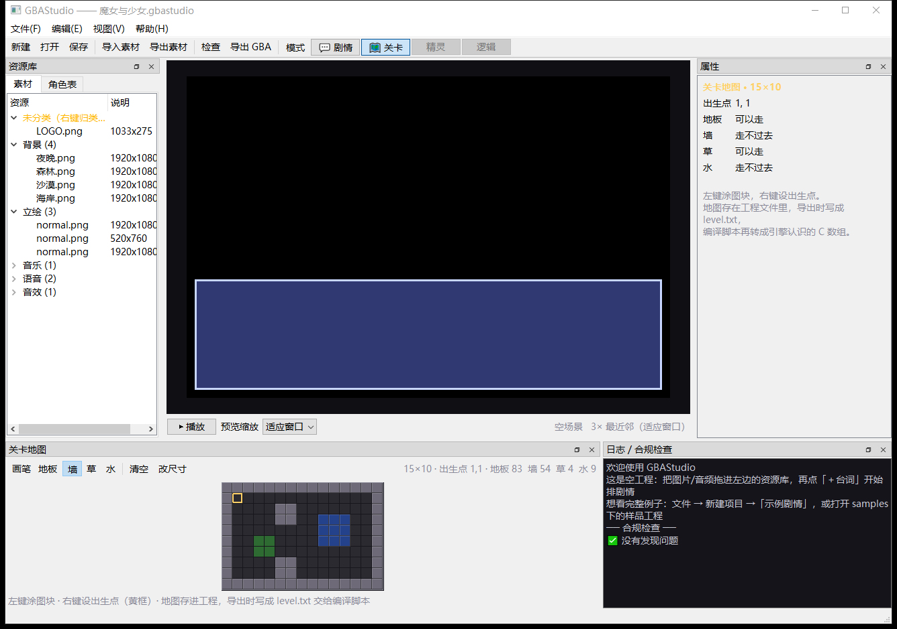
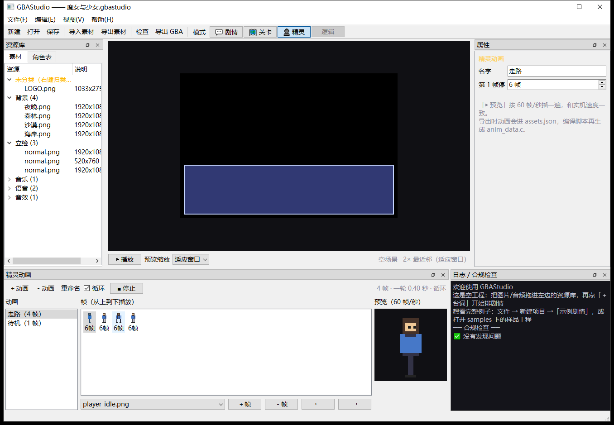
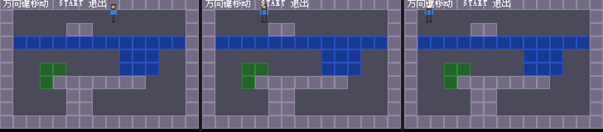
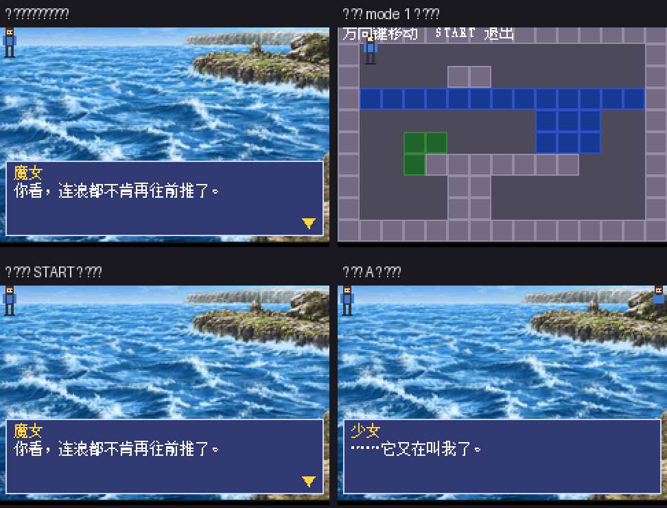
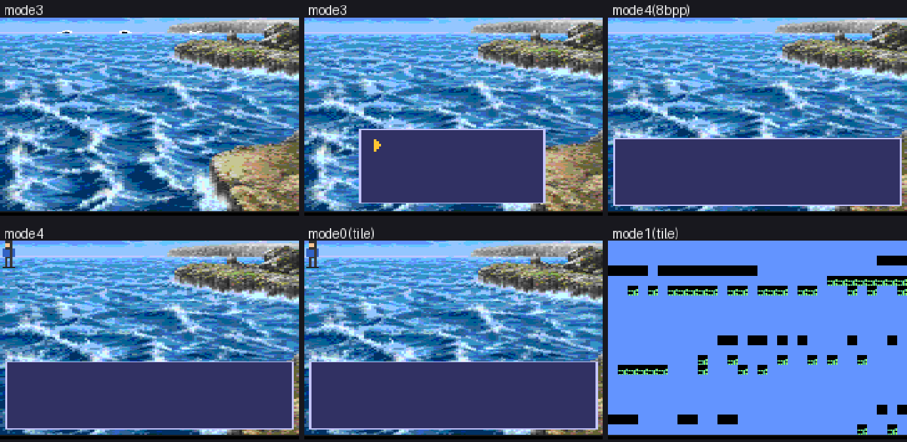
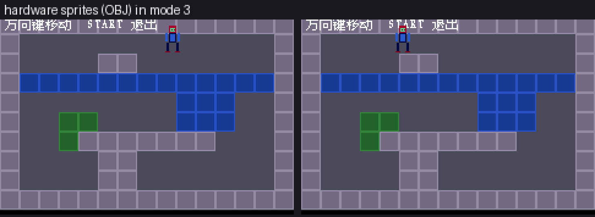

# 开发日志

按时间顺序记录这个工程做了什么、为什么这么做、怎么验证的。
**每个阶段都写了"验证方式"** —— 没有验证的结论不算结论。

---

## 阶段总览

| 阶段 | 做了什么 | 关键产物 | 验证方式 |
|---|---|---|---|
| **P0** 环境 | 装工具链（devkitARM + libtonc + mGBA），全部落工程目录内 | `.toolchain\` `scripts\setup-*.ps1` | `build.ps1` 编译通过，ROM 头合法 |
| **P1** 第一个 ROM | 模式 3 位图引擎 + 中文点阵字库 + 对话框 | `gba_ai.gba` `tools/make_cjk_font.py` | mGBA 截图（中文字形正确） |
| **P2** 编辑器骨架 | 时间轴 / 资源库 / 属性 / 模式切换 | `gbastudio\` | 6 个界面结构测试 |
| **P3** 真实预览 | 编辑器里渲染 240×160，**和实机逐像素一致** | `gbastudio\core\preview.py` `tools\check-preview.py` | 逐像素对比：差异 ≤0.13% |
| **P4** 导出链路 | 时间轴 → 剧本 → 工具链 → ROM | `gbastudio\core\compiler.py` `gba_build.py` | 样品工程端到端出 ROM（2.6 秒） |
| **P5** 引擎升级 | 资源不再写死：任意背景/立绘/表情/位置 | `tools\make_project_assets.py` | 真机显示 4 背景 3 立绘（含居中） |
| **P6** 音频 | 语音/BGM/音效（Direct Sound A/B + DMA） | `source\sound.c` `tools\make_project_audio.py` | 硬件寄存器读数 + ROM 数据逐字节核对 |

---

## P0 · 环境（最早）

**决策：路线 C —— libtonc + devkitARM。**
比较过三条路：C + libtonc（专业、工具链成熟）、C + 自己写一切、以及各种现代替代方案。
libtonc 自带大量教程和寄存器封装，社区资料最多，所以选它。

**国内网络适配**是这一步的主要工作：GitHub 和 devkitPro 官方源不可达，
所以所有下载都改走可达的镜像，并**校验 SHA256**。
产物全部落在工程目录内（`.toolchain\` `.tools\`），不写注册表、不需要管理员权限。

> 踩坑：7-Zip 官方没给 `7zr.exe` 的哈希、文件也没数字签名 ——
> 这一点写在 `scripts\setup-emulator.ps1` 的注释里，没有假装它安全。

---

## P1 · 第一个能跑的中文 galgame

GBA 不支持中文，这是整个工程的**核心难点**。解决办法：

1. 用 GDI 从**中易宋体**里找到内嵌点阵（12px/13px/14px/16px 才有，其余是轮廓线抗锯齿）
2. 按剧本**按需生成**字库 —— 只打包游戏里真正出现的字
3. 存储用 11×11 定长格子（定长才能二分查找），ASCII 只占半宽 6px

**验证**：`[font] 源字号命中内嵌点阵 ✅（灰度级 2）` ——
灰度级 = 2 说明命中的是内嵌点阵（锐利），>2 说明是抗锯齿轮廓（发虚）。
这个指标是判断"字号选对没有"的客观依据，不靠肉眼。

同时做了自动化验证手段：`scripts\dev\mgba-drive.ps1`
（PostMessage 发按键 + PrintWindow 截图），因为**模拟器截图是唯一能看见实机画面的方式**。

> 踩坑：mGBA 默认"失焦就暂停"，自动化截图会全黑 → 配置文件里关掉。
> 踩坑：`keybd_event` 会把按键打进用户正在用的窗口（隐私事故）→ 改用自动播放宏。

---

## P2 · 编辑器骨架

**决策：方案 A —— Python + PySide6（Qt）。**
之前评估过 Tkinter（丙方案）和纯 C 的 GUI。结论：Tkinter 撑不起多模式的复杂界面，
纯 C 在 Windows 上要拖一个 GUI 库进来、开发效率极低。
Qt 实测启动 157 毫秒（之前以为的"3~5 秒"其实是 PyInstaller 单文件解包时间，不是 Qt）。

**架构关键：三层可分离**

```
引擎基础层（C，GBA 上跑）
数据模型层（Python，和界面无关）      ← core/project.py
编辑器外壳（Qt）                      ← ui/ modes/
```
只有最外层是"换起来便宜"的。所以数据模型从一开始就按通用设计（
`TRACK_TYPES` / `Track` / `Clip` / `GObject`），加游戏类型 = 加一个 Mode 模块。

**时间轴采用"混合时间模型"**：galgame 的时间要等玩家，所以一句台词可以是
`等按键` / `等语音结束` / `两者都行` / `固定时长`，不是一个死的时间轴。

---

## P3 · 真实预览（所见即所得）

目标：编辑器中央的画面和实机**逐像素一致**。做法是三条线共用同一套代码：

| 环节 | 实机 | 编辑器 |
|---|---|---|
| 布局常量 | `source/galgame.c` | `core/preview.py` 同名常量 |
| 排版换行 | `text.c` 的 `text_layout` | `layout_text()` 照着重写 |
| 字形点阵 | `tools/make_cjk_font.py` | **import 同一个模块** |
| 立绘转换 | `tools/make_assets.py` | **import 同一个模块** |
| 色深 | 硬件 5 位色 | `quantize_bgr555()` 同样量化 |

**验证**：`tools\check-preview.py` 拿 mGBA 真截图逐像素比。

```
s7.png   差异 1 像素    0.003%   ✅
s9.png   差异 50 像素   0.130%   ✅
s6.png   差异 39 像素   0.102%   ✅
```

> **重要教训**：一开始用公式估算游戏区在窗口里的位置，偏了 1 像素 ——
> 差异率从 0.003% 飙到 57%，看起来像"渲染完全不对"。
> 改成**穷举搜索正好 240×160 的整数裁剪**后才对。
> **对比测试必须先对齐，否则结论毫无意义。** 我差点去改本来正确的渲染代码。

其他两个坑：立绘找错目录（`make_character` 按编译时的约定找图）导致**静默空白**；
忘了量化 5 位色导致编辑器比实机"更顺滑"（实机会有色带）。

---

## P4 · 导出链路 + 样品工程

```
编辑器排时间轴 → 编译成剧本 → 调现有工具链 → ROM
   .gbastudio         scenario.txt    PowerShell    492 KB
```

**没有重写任何编译逻辑**：中文点阵字库、素材转换、ARM 编译还是原来那套 C 工具链，
编辑器只负责把时间轴翻译成剧本。

### "出个样品测试一下" —— 这一步的价值立刻体现

样品工程（`tools\make_sample.py`）一跑，**立刻抓出两个编译器 bug**：

| bug | 现象 | 原因 |
|---|---|---|
| 说话人丢了 | `say \|海风停了。` | 只给立绘片段解析角色，台词片段忘了 |
| 隐藏不生效 | 出现两次 `char right girl` | 动作有时存 `props['action']`、有时存 `kind`，只看了一处 |

两个都**编译不报错**，只有跑通全链路才暴露。

> 这一步的教训：**"能编译"和"对"是两件事**。样品必须真的跑起来看。

---

## P5 · 引擎升级（资源不再写死）

之前引擎只认识写死的 5 个资源（两张背景、两个立绘、一个 LOGO）✗。
现在由项目素材生成索引表，**任意数量**都能用。

### 先算了一笔账：为什么不用硬件精灵（OBJ）

| 项 | 数值 |
|---|---|
| GBA 的 OBJ 显存 | **32 KB**（总共） |
| 单个 OBJ 最大 | 64×64 |
| 111×120 的立绘要拆 | 2×2 = 4 块 |
| 8 位色下 4 块 | 16 KB → **32 KB 只够放 2 块** |
| 两张立绘同屏 | 12 块 = 48 KB → **超了** |
| 降到 4 位色（16 色） | 放得下，但**全彩立绘压成 16 色就毁了** |

**结论：继续用软件绘制（模式 3）是对的。** 代价是没有双缓冲，
但静态 galgame 画面只在换背景那一两帧可能撕裂。这是权衡，不是遗漏。

### 验证

真机上跑出 **4 张背景 + 3 个立绘（含居中位置）**：


测试素材是**程序生成**的（绿色森林、星空夜晚、石头人），风格和真素材完全不同 ——
一眼就能确认"这个资源真的进了 ROM"。

> 坑：`convert()` 里判断 `kind == 'char'`，调用方传的却是 `'spr'` ✗
> → 三张立绘全按背景转成 240×160（丢掉透明、体积大三倍）。
> **编译不报错**，靠核对构建日志里的尺寸才发现。

---

## P6 · 音频

GBA 只有 **2 路 PCM**，所以"语音 + BGM + 音效同时响"做不到。
分工：**DS A 放语音，DS B 放 BGM，音效抢占 B 并在播完后把 BGM 接回原位置**。

数据：8 位有符号 / 单声道 / 11025Hz = **11 KB/秒**。
一句话 3 秒 = 33 KB，2 分钟 BGM = 1.3 MB。卡带 32 MB，采样率就是音质与容量的直接取舍。

### 怎么验证我听不见的东西

我没有耳朵，所以分两层验证：

**静态**：转换产物与 ROM 内容**逐字节比对** ✓ 峰值 113/127（不是静音）✓ 时长一致 ✓

**动态**：mGBA 有 GDB 调试接口，但新版 `arm-none-eabi-gdb` 和它**协议不兼容**
（一上来探测特性，mGBA 不答，握手超时）。所以自己写了个最小客户端
（`tools\read_regs.py`，直接用远程协议的 `m` 包读内存）：

| 寄存器 | 读数 | 含义 |
|---|---|---|
| `s_bgm` | `0x0807B38C` | = `snd_clips[0]` 地址，引擎在播这条 BGM |
| `SOUNDCNT_X` | `0x0080` | **总开关已开** |
| `SOUNDCNT_H` | `0x300C` | **DS A/B 左右输出全开 + 100% 音量** |
| `TM1CNT` | `0x0080` | **BGM 定时器在跑** |
| `s_frame` | `0x2AA` | 跑了 682 帧没崩 |

**能保证"通了"，不能保证音质。**

> 坑：GDB 客户端一连上，mGBA 会把游戏**复位** ✗
> 第一次读出来 `s_frame=0`、所有寄存器都是复位值 ——
> 差点据此得出"音频完全没工作"的错误结论。
> 正确流程是连上后先发 `c`(continue) 让它跑，再中断读取。
>
> 坑：只生成了 `snd_clips[]` 的声明没生成定义 → 编译全过、**链接失败**。
> 现在生成 `snd_table.c` 放定义，没有音频时也生成空表。

---

## 反复踩到的坑（值得单独列出来）

### 1. PowerShell 脚本必须带 UTF-8 BOM

本会话踩了**三次**。不带 BOM 时 PowerShell 5.1 把中文注释读成乱码，
解析器直接崩（`UnexpectedToken`）。**用编辑工具改 `.ps1` 之后要检查 BOM。**

### 2. `%TEMP%` 在这台机器上不能用

- `tempfile.mkdtemp()` 建的目录带受限权限，沙箱里的 Python 写不进去
- PyInstaller 单文件默认解包到 `%TEMP%` → `Could not create temporary directory!`
- **对策**：临时目录一律用工程内的 `.tmp\`；打包加 `--runtime-tmpdir`

### 3. `shutil.copy2` 会连只读属性一起复制

源素材来自只读的附件库，`copy2` 把只读标记也带过来了，
之后删/改素材就 `PermissionError`。**导入一律用 `copy` + 显式清只读。**

### 4. 静默失败最坑

- 缺字库 → 屏幕上一片**空白**（不是乱码，是空白，很容易误判成显示 bug）
- 立绘找不到 → **静默返回空图**，表现为"预览里立绘凭空消失"
- 音频格式不支持 → 如果不报错，会做半天不知道为什么没声音

**对策：所有"找不到/不支持"都要明确报出来。** 编辑器的合规检查和预览信息栏
现在会直接写"角色表里没有 id=xxx"、"xxx 是 mp3 格式，先转 WAV"。

### 5. 对比测试必须先对齐

P3 那次 1 像素的偏移让差异率从 0.003% 变成 57%。**先对齐，再比较。**

---

## 重要决策清单（及理由）

| 决策 | 理由 |
|---|---|
| 路线 C：libtonc + devkitARM | 资料最多、工具链成熟、国内可镜像 |
| 全部用 C（不用 C++/脚本） | 设备老旧，去掉运行时开销和额外工具链依赖 |
| 编辑器用 Python + PySide6 | 启动 157ms；Tkinter 撑不起多模式界面 |
| 保留模式 3 位图（不上图块引擎） | 图块=16 色，全彩背景/立绘会毁掉画面 |
| 立绘用软件 blit（不用 OBJ） | OBJ 显存 32KB 装不下大尺寸全彩立绘（见 P5 算账） |
| 时间轴用"第几句"刻度而非秒数 | galgame 作者关心的是句子顺序，不是秒数 |
| 语音重叠是**硬错误** | GBA 只有 1 路语音通道，重叠必然丢声音 |
| 数据模型三层分离 | 只有编辑器外壳是"换起来便宜"的 |

---

## 当前状态

```
构建：build.ps1 → gba_ai.gba（492.9 KB，2.9 秒）
     素材 4 背景 + 3 立绘 + LOGO（403 KB）+ 音频 4 条（69.4 KB）
测试：python tests\run_all.py → 8 个测试全绿（7.2 秒）
验收：python tools\check-preview.py → 预览与实机逐像素一致
```

**还没做**：特效（淡入淡出/震屏）、选项分支、卡带存档、
编辑器里试听音频、OGG/MP3 直接导入。

---

## 环境整理（P6 之后）

工程长到一定程度后做了一次收口，四件事：

### 1. 框架审查 → [15-框架审查与扩展路线.md](15-框架审查与扩展路线.md)

结论：**简洁性达标**（引擎约 1260 行、依赖 1 个、构建 3 秒、测试 7 秒），
**扩展性是"编辑器可以、引擎差一层"** ——
`text` / `sound` / `gfx` 三个模块直接可复用，但 `galgame.c` 538 行把
"VN 机制"和"游戏状态机"混在一起，需要拆。

给出的路线：P7 拆单体（纯重构，不改行为）→ P8 关卡模式 → P9 精灵动画 → P10 剧本变量。
**同时明确列出"现在不做"的东西**（通用 ECS、字节码 VM、图块压缩…）——
没有第二种游戏类型的真实需求时，造出来的抽象一定是错的。

### 2. 改名：studio2 → gbastudio

编辑器名定为 **GBAStudio**。同时：

- 工程文件扩展名 `.gba2` → **`.gbastudio`**，格式标记就是 `gbastudio`
- **不做旧格式兼容**；但加载时会核对格式标记 ——
  拿错文件会明确报错，而不是"读进来一个空工程"让人对着空白界面发愣
- 改名用脚本做（涉及 24 个文件的路径引用），改完**立刻跑测试**验证，
  避免"漏改一处导致测试莫名失败"

### 3. 文件分类

```
素材：graphics\ + audio\test\   →  assets_src\images\ + assets_src\test\
                                   （"人手准备的东西"只留一个入口）
截图：docs\*.png                →  docs\screenshots\
测试：.tmp\t_*.py               →  tests\test_*.py + run_all.py 一键跑
工具：.tmp\read_regs.py         →  tools\（通过 mGBA 调试接口读硬件寄存器）
```

**刻意没动的**：`source\` `include\` `scenario\` 是 C 工程的常规布局、
构建脚本依赖它；`tools\` 保持平铺（脚本按完整路径调用，挪动收益小于风险）。

顺手修掉一个隐患：测试里写死的绝对路径（`D:\GitHud\GBA_AI\...`）
全改成**从文件位置推导** —— 工程挪盘也不会断。

### 4. 代码精简

写了个小工具（`tools/dev/find_dead.py`）按"名字在整个工程里只出现一次"
找出没人用的定义，再逐个人工确认：

| 删掉的 | 为什么 |
|---|---|
| 6 个没用到的硬件常量 | `assets.py` 里写着一堆"硬件限制"，实际只用了 `MAX_OBJ` |
| `guess_kind` | 导入不再自动分类（P2 改的），没人调了 |
| `write_manifest` | 和 `gba_build.export_rom` 里的功能重复 |
| `text_width` / `render_scaled` | 预览模块里没人调 |
| `TRACK_ORDER` / `unclassified` / `FORMAT_LEGACY` | 没人用 |
| `QSize` / `QGroupBox` / `KIND_LABELS` / `tempfile` | 没用到的导入和常量 |
| `timer_value` | 采样率换算在 C 侧做，Python 只写 rate |
| `find_gba_project`（`main.py` 那份） | 和 `gba_build.py` 里的重复，统一成一份 |

**保留但当前没被调用的**：`console.c`（ASCII 调试文字）——
它是 [04-学习路线](04-学习路线.md) 里承诺的调试手段，
删掉就没有这个后备了。**这类东西不擅自删，列出来由你决定。**

> 精简的真正难点不是"找出没用的代码"，而是**分清"没用"和"暂时没用到"**。
> `paint` / `closeEvent` / `dragMoveEvent` 在静态扫描里同样是"只出现一次"，
> 但它们由 Qt 框架回调，删了功能就坏。
> 所以脚本只报告，改动全部人工确认。

### 整理后核对

| 项目 | 结果 |
|---|---|
| 完整重建 | ✅ ROM 492.9 KB（字节数与整理前一致） |
| 8 个回归测试 | ✅ 全绿（7.2 秒） |
| 预览 vs 实机 | ✅ 仍逐像素一致 |
| 编辑器启动 | ✅ 正常（窗口标题 GBAStudio） |
| 测试素材重新生成 | ✅ 脚本路径已跟随新目录 |
| 文档死链 | ✅ 无 |

---

## 界面缩放（整理之后补的基础功能）

用户反馈两条：**界面字体大小要能调**、**小组件大小要能随意改**。

### 界面字体可调

视图 → 界面字体（小 8 / 标准 9 / 大 11 / 特大 13），改完立刻生效并记住。

关键点：**光改字体不够，时间轴的尺寸也得跟着走** ——
轨道行高、轨道名列宽、拖拽命中范围全部乘一个缩放系数
（`timeline.apply_ui_scale()`）。不这么做的话，字体一大，
轨道名和片段标签就挤成一团，"调大字体反而更难看了"。

```
小  8 号 → 行高 21, 列宽  75
标准 9 号 → 行高 24, 列宽  84
大 11 号 → 行高 29, 列宽 103
特大 13 号 → 行高 35, 列宽 121
```

### 面板能自由缩放（这里面有个真 bug）

原来时间轴面板**最小宽度 1258 像素**，根本拖不小。
原因不是设了 `setMinimumWidth`，而是**那一排按钮**（＋台词 / ＋立绘 / … / ＋轨道）
把整行的自然宽度撑住了 —— Qt 里控件的 `minimumSizeHint` 会顺着布局往上传，
最后变成整个停靠面板缩不小。

改法：按钮排换成 **QToolBar**（宽度不够时自动收进右侧的 » 溢出菜单）。
最小宽度从 **1258 → 87**。

顺带去掉的硬限制：
- 中央预览面板的 `setMinimumWidth(420)`
- 时间轴 `setMinimumHeight(190)` → 70
- 工具栏按钮的 `setFixedHeight(24)`（字体调大后要能跟着长高）

### 新增：预览「适应窗口」

原来的缩放只有 2×/3×/4× 三档。现在多了**适应窗口**（默认）：
面板多大就显示多大，**取整数倍** —— 最近邻缩放用非整数倍会让像素大小不一
（有的胖有的瘦），看着很难看。另外支持在预览上 **Ctrl+滚轮**缩放。

### 又一个真 bug：设置**从来没存住**

做这个功能时发现：界面偏好原来用 `QSettings('GBAStudio', 'Editor')`（默认写注册表），
**写完立刻读回来是 `None`** —— 也就是字体、缩放、窗口布局这些设置一直是"改了下次就忘"。

排查过程：
1. 以为是 `sync()` 的问题 → 加了 sync，还是 None
2. 打印 `QSettings.status()` → 报 `NoError`（**误导性的成功**）
3. 换 INI 文件 → 发现 `%APPDATA%` 在某些受限环境里**根本不存在**，
   于是路径退到用户主目录，而那里又写不进去，QSettings 依然不吭声

最终方案：存 **`%APPDATA%\GBAStudio\settings.ini`**（INI 文件，不是注册表），
并支持环境变量 `GBASTUDIO_SETTINGS` 覆盖（便携安装和自动化测试用）。
写失败会**明确打印警告**，不再静默。

选 INI 而不是注册表还有个好处：**能直接打开看、能随工程备份**，
也和这个工程"不写注册表、不污染系统"的一贯做法一致（安装脚本同样如此）。

### 新增测试 `tests/test_ui_scale.py`

覆盖：字体逐档生效、时间轴尺寸跟着变、面板没有被写死的最小/最大尺寸、
把面板拖小后预览自适应、选择被记住。跑一遍 0.7 秒。

> 这次修的两个问题（面板最小宽 1258、设置存不住）都是**用户反馈的界面问题背后
> 藏着实现缺陷**。表面看是"字体不好调、面板拖不大"，实际是布局自然宽度
> 和配置持久化的问题 —— 值得记一笔。

---

## 时间轴去刻度（接着的小改动）

用户反馈：顶部的「句」和 1/2/3 序号**不需要**。

回头看，那个"以第几句为坐标"的设计是**我推的**（当初用户只说"秒数刻度不需要"，
我顺势换成了句子序号）。实际用起来序号是多余的：**片段自己就带着台词内容**，
序号既占地方又要跟着对。教训：**用户说"不需要 A"时，不要顺手换成 B 再问他行不行。**

改动：
- 顶部**不画任何刻度**（秒数、序号都不画），只留一条窄条放播放头把手，
  并保留"点一下移播放头"的操作
- 片段标签去掉 `#N` 前缀，直接显示台词内容
- `dialogue_marks()` 保留（预览信息栏的"第 N 句"还用得到），
  `ordinal_of()` 删掉（没人用了）
- 操作提示同步改口径（"拖动顶部标尺" → "点最上面那条"）

### 顺带修的一个显示问题

时间轴内容原来**垂直居中**：QGraphicsView 默认把小于视口的场景摆在正中间，
面板一拉高，上方就空出一大片（看着像少了东西）。
加一行 `setAlignment(Qt.AlignLeft | Qt.AlignTop)` 让它贴左上角。

> 测试也跟着改了：`test_ruler.py` 现在断言**顶部窄条区域里不能有任何文字**
> （用 `scenePos()` 判断 —— 片段标签是片段的子项，`pos()` 是相对父项的，
> 我第一次就写错了这个，测试报"顶上还画着东西"，其实是坐标取错了）。

---

## 语音自动配对 + 一个藏了很久的 id bug

用户提了两件事：台词的属性里选语音、选完时间轴**自动出现对齐的语音片段**
（保留手动）；以及资源库右键"没反应、没有分类选择"。

### 1. 语音自动配对

台词属性里那一栏现在是「**语音（自动配对）**」，三个选项：

| 选项 | 行为 |
|---|---|
| 自动（按命名约定找） | 按角色的 `voice_prefix` 找语音文件（如 `witch_0101`） |
| 具体文件 | 用它，并在时间轴生成对齐的语音片段 |
| （无语音） | 把关联的语音片段删掉 |

**难点是"自动跟随"和"手动调整"不能打架**。做法是在语音片段上记一个
`sync_start`（上次同步时台词的起点）：

```
语音起点 == sync_start  →  台词动了  →  把语音拉过去（自动跟随）
语音起点 != sync_start  →  用户拖了  →  解除关联，尊重他的调整
```

这样"自动为主、手动可用"才成立 —— 不然用户一拖就被拉回去，根本没法手动调。

其他行为：删台词时自动生成的语音一起删、**手动放的语音不动**；
手动语音片段被拖过之后转为手动，不再跟随。

### 2. 资源库右键（用户反馈的真 bug）

两个毛病：
- **分类菜单套了两层**（`归类为 ▸ 归类为 ▸ 背景`）—— 我把一个已经带
  "归类为"子菜单的菜单又 addMenu 进来改名，用户根本找不到分类项
- **右键分类标题行只弹出"导入素材"一项**，看着就像没反应

现在分类项直接建在主菜单里（一层），右键标题行会明确提示
"（选中具体的素材文件才能归类）"。

### 3. 顺手挖出一个藏了很久的 bug：**所有片段 id 完全相同**

给语音做关联时需要"按 id 找片段"，结果发现**整个工程里所有片段的 id 都是
`c6679282`**。

原因：id 用 `int(time.time() * 1000000 % 100000000)` 生成，
而 **Windows 上 `time.time()` 的精度只有约 15.6 毫秒** ——
快速循环里创建的十几个片段全拿到同一个时间戳。

后果（都是静默的，很难查）：
- 台词和语音的关联会找到**错误的对象**（我这次就是被它坑的）
- 按 id 删片段会**一次删掉一串**
- 任何按 id 查找的逻辑都不可靠

有个细节特别值得记：`test_data.py` 里有一条"删一个片段后应该剩 0 个"的断言，
**在这个 bug 下一直是"通过"的** —— 因为它按 id 删，而 id 全一样，
一次把两个都删了，正好凑出 0。修好 id 之后这条断言立刻失败，
才暴露出原来那个"正确结果"是假的。

修法：id 改成"时间戳 + 递增序号"，同一毫秒内也不会重复；
并且**加载旧工程时自动修复重复 id**（顺手清理失效的语音关联）。

新增测试 `tests/test_voice_link.py`（0.7 秒）覆盖语音配对的 6 种行为；
`test_ui.py` 增加了右键菜单的结构断言。

---

## 属性栏改名 + 宽度问题（用户反馈）

两件事：「检查器」改名为「属性」；**选中文本片段后属性栏左右拖动显示会出错**。

改名是全局的（界面标题、代码注释、文档、测试说明），统一成"属性"一个叫法。

宽度那个是真 bug，根因是**几处文字把面板的最小宽度顶住了**：

| 顶宽的东西 | 最小宽度 | 为什么 |
|---|---|---|
| 标题两行（`第 1 句 · 台词 · c99478563_4`、`轨道 text （下面这些是排布用…）`） | 195 / **295** | QLabel 默认"最小宽 = 整行文字宽" |
| 下拉框 | **156** | Qt 默认"最小宽 = 最长选项宽"，语音文件名一长就撑开 |
| 表单标签列 | 112 | QFormLayout 默认不让标签换行 |

加起来把属性栏的最小宽度顶到 **290 像素**，往左拖过这条线布局就乱。

修法（都是 Qt 的标准做法）：

- 标题行 `setWordWrap(True)` + `setMinimumWidth(1)` —— 文字长了换行
- 下拉框 `setSizeAdjustPolicy(AdjustToMinimumContentsLengthWithIcon)`
  + `setMinimumContentsLength(8)` —— 按 8 个字符算最小宽，长了自动截断
- 表单 `setRowWrapPolicy(WrapLongRows)` —— 面板窄时标签挪到输入框**上方**

结果：最小宽度 **290 → 141**，实际能拖到 120 像素。

> 这类问题的共同点：**控件的"最小宽度"是从内容算出来的**，而内容长度是变的。
> 凡是显示可变文字的控件，都要显式压一下最小宽度，否则"面板拖不小"
> 会在某个特定数据下突然出现 —— 选中别的片段没事，一选中文本就不行，
> 因为那行的字最长。

`test_inspector.py` 增加了断言：**选中任何类型的片段，属性栏最小宽都不能超过 200**，
并且实际拖到 150 能成功。以后再加"会变长的文字"时，测试会拦住。

---

## 空工程启动 + 默认布局（用户反馈）

三件事：**默认不带素材**、界面干净、默认布局优化。

### 1. 启动给空工程，不再塞示例素材

原来的 `new_project()` 自带两个角色、五个素材条目和 11 个片段 ——
一打开编辑器就满屏"素材"，可那些路径在磁盘上**并不存在**，
既乱又误导（以为工程里真有东西）。

现在拆成两个函数，用途分清：

| 函数 | 内容 | 什么时候用 |
|---|---|---|
| `blank_project()` | 空场景 + 6 条默认轨道，**不带任何素材** | 启动时、新建→空白 |
| `demo_project()` | 角色/素材/一段剧情 | 只在新建→「示例剧情」时 |

启动日志也换成两行有用的指引（拖素材进来、想看例子去哪找），
空工程**不再跑合规检查**（否则一屏"没素材"的提示）。

### 2. 默认布局：让时间轴一打开就看得见全部轨道

原来时间轴只露出最上面一条 ✗，新用户会以为"只有一条轨道"。

查下来有两个原因，都是**控件在抢空间**：

- **预览图在抢高度** ✗：QLabel 默认把"图片尺寸"当成自己的推荐尺寸，
  而预览是"适应窗口"模式 —— 面板一大就要求更多高度，越滚越大，
  把时间轴挤成一条缝。修法：`setSizePolicy(Ignored, Ignored)`，
  预览是监视器，显示多大由面板决定，不该反过来提要求。
- **`resizeDocks` 会打折** ✗：实测请求 230 像素只给到 **134**。
  修法：先用 `setMinimumHeight(需要的量)` 做**硬约束**（Qt 一定满足），
  等布局稳定（300 毫秒）后再放开成软限制，用户照样能拖小。
  日志面板同理，先临时限高 130，之后恢复。

```
时间轴控件高 234（需要 164 放 6 条轨道）→ 能看见 6 条 ✓
放开限制后能拖到 134 像素（用户可自由调整）✓
```

> 这两个都是老问题：**上一次修的是"面板拖不小"，这次是"面板被打不开"** ——
> 根子都在"控件的推荐尺寸"上。Qt 里凡是"内容驱动的尺寸"，
> 都要显式声明自己的意图（Ignored / WordWrap / 最小宽 1 像素…），
> 否则默认策略总会在某个方向跟你作对。

### 3. 测试跟着改

三个测试原来依赖"启动自带示例内容"，现在改成**显式加载样品工程**
（本来也更真实）；`test_ruler.py` 里写死的"台词 3 句"改成按实际数量断言。

---

## P7 · 拆开 `galgame.c` 单体

538 行的单文件里挤着四种东西：界面状态机、对话框/立绘/剧情执行、
菜单绘制、按键处理。想做第二种游戏类型（关卡模式）时，
这里只有"菜单和按键"能复用 —— 但它们是混在一起的。

### 拆成了什么

| 文件 | 行数 | 职责 | 换游戏类型还要吗 |
|---|---|---|---|
| `game.c/h` | 44 | 帧计数 + 界面栈（标题→剧情→暂停，压栈出栈） | **要** |
| `input.c/h` | 61 | 动作映射（确认/取消/上下/菜单）+ 自动演示注入 | **要** |
| `ui.c/h` | 46 | 通用菜单/面板/消息页（样式用一张表描述） | **要** |
| `vn.c/h` | 298 | 剧本执行 + 对话框 + 立绘 + 选项 | 不要（VN 专用） |
| `galgame.c` | **538 → 283** | 界面状态机 + 接线 + 菜单位置 | 不要（这个游戏的玩法） |

`gfx.c` / `text.c` / `sound.c` **一行没动** —— 它们本来就是通用层。

### 拆的时候特意处理的几件事

**1. 界面切换从引擎里搬出来。** 原来剧本执行到 `CMD_CHOICE` 会直接写
`s_state = GS_CHOICE` —— 引擎凭什么知道"选项界面"是什么？
现在 `vn_run()` 返回一个 `VnStop`（说话/选项/结束），由应用层决定切到哪。
这是"引擎不依赖界面"的关键一步。

**2. 三种菜单合成一个。** 标题菜单、暂停菜单、选项菜单本质是同一个东西
（框 + 若干项 + 高亮 + 左边三角），原来各写一遍。现在 `ui_menu()` 一个函数，
差别用 `UiMenuStyle` 那张表描述。以后加菜单只写数据。

**3. 界面栈替掉 `s_back`。** 原来"消息页返回时回到哪"靠一个 `s_back` 变量记，
界面一多就不够用。现在 `game_state_push/pop`。

### 一处**故意的行为修正**（和一处忍住的）

- **改了**：进入选项界面时**没画菜单**，要等玩家先按一下方向键才出现 ——
  原来的 bug。现在进界面就画。（样例剧情里没有选项，所以以前没人发现。）
- **没改**：`vn_begin()` 时上一句的台词还留在对话框里（重玩会闪一下旧台词）。
  虽然知道是瑕疵，但 P7 的约定是"纯重构不改行为"，单独提出来再改。

### 验收：怎么证明"画面没变"

先说**失败的办法** ✗：mGBA 的截图是按**真实时间**抓的，两次运行会累积几帧到几秒的
漂移 —— 打字机差一两个字、▼ 闪烁差半个周期、甚至抓到完全不同的剧情位置。
20 张里只有 5 张能对上，这种对比证明不了任何东西。

**能用的办法** ✅：截出来的画面里，**游戏区域逐像素相同的有 5 帧**
（标题画面、以及剧情中的几帧，**0 像素差异**）；其余差异全部 ≤0.8%，
且都落在"打字机进度"和右下角 ▼ 的闪烁相位上 —— 是时间抖动，不是画面变化。

**为这件事专门写了个工具** `tools/frame_hash.py`（帧精确对比）：
用 GDB 桩读游戏自己的帧计数 → 等到指定帧 → 中断 CPU 冻住画面 →
把 mode 3 的显存整块读回来算校验和。再配一个 `GAL_FREEZE_AT=N` 编译宏，
让 ROM 自己停在第 N 帧，两版 ROM 就能在同一帧号上比校验和。

> **这个工具还没完全跑通**：两个问题已经解决（桩的读取上限是 256 字节；
> `0x03` 中断后的停止包要先收走），但"冻结版 ROM 在 GDB 下读显存"这一步
> 仍然超时。**没有验证过的东西不当作验证过** —— 所以 P7 的结论只用
> 上面那 5 帧逐像素一致的证据。工具留在仓库里，状态标注清楚，以后再修。

### 核对

```
10 个编辑器测试全绿（10.1 秒）
ROM 重建 ✅ 504,944 字节（重构前 504,844，+100 字节）
自动演示录屏：5 帧逐像素完全一致，其余差异 ≤0.8% 且都是时序抖动
```

### 教训

交换 `source\` 里的文件来编"重构前"的版本时，我**没有先备份**，
旧文件把刚写好的 `galgame.c` 覆盖了 ✗，只能整份重写。
**动别人的文件之前先备份** —— 哪怕只是"临时换一下"。后来把重构后的代码
备份到 `.tmp\p7new_src\` 才敢继续做对比编译。

---

## P8 · 关卡模式（验证"多类型"到底成不成立）

P7 拆出来的四层到底能不能复用？光看代码不算数，得真的写出第二种玩法。
P8 就是这一步：**图块地图 + 方向键走的角色 + 碰撞**，从编辑器一路做到实机。

### 引擎侧：`level.c`（146 行）

和 `vn.c` 并列，共用 `game` / `input` / `ui` / `gfx` 四层。

三个被现有渲染方式逼出来的决定：

| 决定 | 原因 |
|---|---|
| **地图只画一次** | 引擎是模式 3（位图，没有硬件图块），16×16 的格子只能软件填色。地图是静止的，进关卡画一次就够 |
| **擦角色不用 `gfx_restore_rect()`** | 那个函数从"背景**资源**"取像素，而关卡地图是**程序画出来的**，没有对应图片。所以自己写 `redraw_tiles()` 按地图数据重画 |
| **碰撞用四点采样** | 把角色矩形下一步的四个角换算成格子坐标，有一个实心就挡住。比逐像素快得多，对格子地图足够准 |

### P8 逼出来的改动（这正是它该干的事）

1. **`input.c` 缺左右方向** ✗ —— P7 抽 input 时是照着 VN 的需要做的，只有上下。
   关卡模式一上来就露馅。补了 `ACT_LEFT` / `ACT_RIGHT` / `input_axis()`。
   **抽象是照着当时的需求做的，换个用法就会暴露偏向** —— 这就是要早点做第二种玩法的理由。
2. **标题菜单要能选玩法** —— 原来的"继续游戏（未实现）"换成"**关卡试玩**"，
   加 `GS_LEVEL` 状态。自动演示里补了左右方向（**VN 从不读左右键**，
   所以剧情模式的演示行为一个字都没变）。

### 编辑器侧：`modes/level.py`（227 行）

```
画笔：地板 / 墙 / 草 / 水      左键涂，右键设出生点（黄框）
清空 · 改尺寸                  信息栏实时显示图块统计
```

**加这个模式只改了一行** —— `modes/__init__.py` 的 `MODES` 表里加 `LevelMode` ✓
主窗口完全没动：模式按钮、菜单、面板布局都是读表生成的。
（当初做模式注册表就是为了这个，这次算验收。）

地图存在工程文件里（`.gbastudio` 的 `level` 字段），导出时写成 `level.txt`，
编译脚本 `tools/make_project_level.py` 再转成引擎认识的 C 数组。

### 踩到的坑：注释符和墙的字符撞了

`level.txt` 第一版用 `#` 当注释符 ✗ —— 可**墙的字符就是 `#`**，
解析时每一行地图都被当成注释跳掉 ✗，结果解析出空地图、**悄悄回退到默认地图** ✗。

最阴的是：**测试"通过"了** —— 往返测试比的是"默认地图 vs 默认地图" ✓
（解析失败 → 回退默认 → 恰好相等 ✗）。

改用 `;` 当注释符，并补了一条专门的断言：
**改过一格的地图必须能和默认地图区分开** ✓ —— 防的就是"解析失败悄悄回退"这类蒙混过关。

### 端到端验收

在编辑器里画一张一眼能认出来的地图（第 3 行整条水、第 6 行一段墙）→ 导出 →
编 ROM → 实机截图：**水墙和墙段一模一样地出现在实机上** ✓
角色从出生点往右走 ✓ 被水挡住 ✓



### 核对

```
11 个编辑器测试全绿（11.7 秒）—— 新增 test_level.py
ROM 505,952 字节（关卡模式 +1 KB）
预览 vs 实机 ✅ 仍逐像素一致
```

### 结论：分层是成立的

`game` / `input` / `ui` / `gfx` / `text` / `sound` 这一层在关卡模式里**原样能用**，
`vn.c` 一行没碰。真正要改的只有一处（input 缺左右）——
而且那是个**本来就不完整**的地方，不是设计错了。

**下一步**：关卡现在还只能一屏、没有镜头滚动、角色是个方块。
要真能玩，接下来是镜头 + 图块素材（现在图块是纯色块）+ 角色精灵（P9）。

---

## P9 · 精灵与动画

P8 结尾写着"角色是个方块"。P9 把它换成**会动的精灵**，并且让动画可以在编辑器里编。

### 数据流：动画也是编译期的事

```
编辑器「精灵」模式编动画  →  存进工程文件 animations
    →  导出时进 scenario\assets.json 的 animations 段（帧解析成绝对路径）
    →  tools\make_project_anim.py  →  source\assets\anim_data.c
    →  引擎 anim.c 查表播放
```

生成的表是三个**平坦数组**，不是嵌套结构体：

```c
anim_frames[]   所有动画的帧按顺序排一起（精灵下标）
anim_durs[]     每帧停多少游戏帧，和上面对齐
anim_defs[]     每个动画一条：从第几帧开始、共几帧、是否循环
```

为什么不用嵌套：GBA 上静态初始化不能含运行期计算，嵌套结构要写一大堆花括号，
**错一个就静默错位**（画面只是"动得不对"，不报错）。平坦数组 + 偏移量最不容易错。

### 两个必须解决的新问题

**1. 立绘的转换规矩不能用在精灵上** ✗

原来的素材转换把**所有**精灵缩放到 120 像素高（那是立绘的规矩）。
16×24 的走路帧照这个规矩拉大就废了。所以新增一种素材类型
`kind == 'sprite'`（「精灵」），走 `make_sprite_native()`：
**只裁掉空白、绝不缩放**。像素画一缩就走形，还会引入半透明边缘。

顺带发现：**不裁空白不行** ✗ —— PNG 画布常常比内容大，
不裁的话每帧的"脚底位置"对不齐，动画一播就上下抖。

**2. 精灵的下标不能被立绘挤走** ✗

`gfx_sprites[]` 里既有立绘又有精灵，而动画表记的是"第几号精灵"。
要是精灵的下标取决于"这次剧本用了几个立绘"，**加一句台词就会让动画全错位** ✗。
所以精灵在清单里单独一组、生成时**排在最前面**，占住 0..N-1。

### 引擎侧：`anim.c`（约 90 行）

只管"播到第几帧、还剩几帧换"，`anim_sprite_index()` 返回精灵下标，
由调用方去查资源表 —— 动画系统不该认识资源表。

`level.c` 接上之后：动起来播「走路」，停下播「待机」。

### 踩到的坑：走一路拖一串小人

第一次跑起来，角色**每走一步都留下一个残影** ✗。原因是**画和擦用了不同的锚点**：

```
画：dx = px + (碰撞盒宽12 - 精灵宽) / 2      ← 拿 12 当锚点
擦：dx = px - 精灵宽 / 2                     ← 拿精灵宽当锚点
```

两者差了 6 像素，**擦的地方根本不是画的地方** ✗。
改成只有一个 `player_anchor()`，画和擦都调它；
擦除时再用一个"比所有帧都大一圈"的框（各帧裁得紧、宽度差一两像素很正常）。

> 教训：**画和擦必须共用同一个定位函数**。这种 bug 不会报错，
> 只会让你看见一串自己 —— 而且第一眼还以为是"没擦干净"。
> 另外还有个更早的版本：擦的时候用了 `s_px`（那时已经更新成新位置了），
> 也是同一个病根：**擦的是"当前位置"，而不是"当时画在哪"**。

### 编辑器侧：`modes/sprite.py`（约 320 行）

```
＋动画 / －动画 / 重命名 / 循环        动画列表（走路 4 帧 / 待机 1 帧）
帧序列（缩略图 + 每帧停几帧）          ＋帧 / －帧 / ← / →   ← 顺序可调
▶ 预览：按 60 帧/秒真播一遍            属性栏：改名字、改这一帧停几帧
```

**预览是重点** ✓：动画对不对，看数字看不出来，播一遍就知道。
预览和引擎用的是**同一套计时逻辑**（按"停几帧"倒计时 ✓ 60 帧/秒 ✓）。

加这个模式仍然只改 `MODES` 表一行 ✓ 主窗口没动。

### 顺带修的一个真 bug（重复实现的代价）

`test_inspector.py` 突然报出 **84 个残留控件** ✗。查下来是：我在新模式的
属性栏里**自己又写了一遍"清空布局"** ✗ —— 而 `story.py` 里早就有一份
验证过的正确实现（递归 + 隐藏 ✓）。抄的那份漏了递归和隐藏 ✗，
被清掉的控件变成**可见的顶层窗口**浮在界面上 ✓。

修法：抽到 `modes/common.py` 的 `clear_layout()` ✓，三个模式共用 ✓。
（顺手解决了循环导入：放 `modes/__init__.py` 里会让模式类 import 到半成品的包 ✓。）

### 核对

```
12 个编辑器测试全绿（10.1 秒）—— 新增 test_anim.py
ROM 508,760 字节（动画 +2 KB）
实机：角色是会动的精灵，走路/待机自动切换，无残影
```




### 还欠着的

- **左右翻转**：朝左走时贴图没有翻转（`gfx` 还没有水平翻转的 blit）。
  走路动画本身看得出在动，先不挡路。
- 精灵表（sprite sheet）：现在一帧一个文件，ROM 才 500 KB，
  空间不紧张，先要的是"在编辑器里直接能看"。真放不下再在编译期合并。
---

## 补齐：剧本里切换玩法（`mode` 命令）

P8 只做到"标题菜单能选玩法"，剧本里切不过去 —— 也就是说**做不成"演到一半开始打关卡"**。
这一节把缺的那半补上。

### 做了什么

| 层 | 改动 |
|---|---|
| 剧本命令 | 新增 `CMD_MODE`（`a` = 玩法编号，见 `scenario.h` 的 `GameMode`）|
| 引擎 | `vn_run()` 遇到 `CMD_MODE` 返回 `VN_STOP_MODE`；**先把 pc 推进一格再返回** |
| 应用层 | 收到 `VN_STOP_MODE` → `game_state_push(GS_LEVEL)`；关卡退出 → `pop` 回 `GS_SCENE` → `vn_redraw()` |
| 编辑器 | fx 轨上新增「＋切模式」片段（fx 本来就是"非画面事件"的轨道）|
| 编译链 | `story 编译器 → mode 1` + `build_script.py → CMD_MODE` |

关键点：**用 push 而不是 set**。这样关卡退出时能 pop 回剧情、
而且 pc 已经停在下一句 —— 剧情接着演，不是被打回标题。

### 验证（全手动按键，不靠自动演示）

```
① 剧情「你看，连浪都不肯再往前推了。」
② 再按 A      → 进关卡          ← mode 1 生效
③ 关卡按 START → 回到剧情        ← 不是回标题
④ 再按 A      → 少女「……它又在叫我了。」  ← 正是 mode 1 的下一句
```



### 顺便挖出来的两个坑

**1. `source\scenario.h` 是个僵尸文件** ✗

工程里有两份 `scenario.h`：生成器只写 `include\scenario.h`，
但 `source\` 下还留着一份很旧的。C 的 `#include "..."` **优先搜源文件所在目录**，
所以 `vn.c` / `galgame.c` 一直包含的是那份旧的 —— 新加的 `CMD_MODE` 死活"未声明" ✗。
删掉僵尸文件即可。**生成物只该有一份，改名/挪位置时记得清旧的。**

**2. 加了片段不等于导出过** ✗

我先给样例剧情加了「切模式」片段，然后只跑了 `build-assets`（它**读** `scenario\scenario.txt`），
却没重跑**导出**（导出才**写**那个文件）—— 结果 ROM 里根本没有 mode 命令，
验证时"剧情直接跳过切模式" ✗ 查了半天。
**数据流的方向要记牢：编辑器导出 → scenario\ → build-assets → ROM。**
---

## 显示模式选型分析（不是改动，是分析）

用户问"GBA 的图层模式（mode 0 四图层 / mode 2 两仿射）有没有做"——**没有** ✗
引擎写死 `DCNT_MODE3 | DCNT_BG2`，全工程没有任何 BG0CNT/BG1CNT/BG3CNT。

顺着这个问题做了一份完整对比：**[docs/16-显示模式对比与选型.md](16-显示模式对比与选型.md)**。
三条关键结论：

1. **位图和图块层不能混用** —— 模式 0/1/2 有图块没位图，模式 3/4/5 有图图块 ✗ 二选一。
2. **OBJ（硬件精灵）在所有模式都能用** —— 而且模式 3 下有 16 KB 图块（够 30 多个 32×32 角色）。
   也就是说**关卡的角色现在就能改成硬件精灵，不必换显示模式**。
3. 模式 3 的短板只有两个：不能双缓冲、程序画的地图不能滚动 ✗
   而"位图滚动"其实可行：整屏 DMA 拷贝约 2 万周期，只占一帧的 7%。

推荐路径：**先做方案 A**（OBJ 精灵 + 位图滚动，不动架构）✓
**再做方案 B**（关卡单独用模式 0，运行时切显示模式）✓
不建议为了双缓冲换模式 4（照片背景会降成 256 色，而图块问题依然没解决）。
---

## P11 · 底层重构：全面支持 GBA 六种显示模式

用户要求"对底层重构，全面支持 GBA 的所有图层模式"。这一节记下**做了什么、
验证到什么程度、还差什么** —— 不夸大。

### 分了三层

```
video.c     六种模式的统一入口：能力表、运行时切换、翻页、图块层开关
surface.c   画布抽象：直色位图（3/5）/ 8bpp 索引（4）/ 图块画布（0/1/2）
gfx.c       原 API 一行不变，只是改成"往当前画布画"
```

**关键设计**：`gfx.c` 的 API 完全没变，所以 `vn.c` / `level.c` / `ui.c` / `text.c`
**一行都不用改** —— 同一套绘制代码跑在任何模式上。

三种后端只在"一个像素写到哪里"上分岔（`sf_put`），其余绘制逻辑共用。

### 图块后端怎么工作

在 RAM 里维护一张 240×160 的**下标图**；每个 8×8 屏幕格对应显存里
**专属的一个图块**（不做图块去重）；写像素时把所在格标脏；
每帧结束 `gfx_flush()` 只把脏格重编码传上去。

颜色对齐：调用方永远写 15 位色，后端查一张 32 KB 的缓存表
（首次遇到某颜色时在调色板里找最接近的，之后一次查表）。
**这就是"全面支持"的代价：图块和 8bpp 模式下颜色降到 256 色。**

### 验证到什么程度

| 模式 | 状态 |
|---|---|
| **3**（16bpp 位图，原用） | ✅ 逐像素回归通过（`check-preview` 仍报"完全一致"）|
| **4**（8bpp 位图，可翻页） | ✅ 画面正确（颜色量化可见）|
| **0**（4 图块层） | ✅ 画面正确（含文字/立绘/对话框）|
| **1**（2 图块 + 1 仿射） | ✅ 画面正确（标题、关卡、OBJ 角色都对）|
| **2**（2 仿射层） | ⚠ **实现完成、但没拿到可靠的画面证据**：写了独立的仿射层模块（`bg.c/h`）+ 关卡的仿射渲染路径；调色板和图块数据都验证正确 ✓，但截图工具连续三次抓错区域 ✗、GDB 读数不稳定 ✗（详见下一节）|

> **一处更正**：我先前说"模式 1 花屏"，是**看错了** ——
> 那两张截图正好卡在模式切换的瞬间（每 2 秒切一次、截图间隔 2 秒）。
> 改成"钉死在一个模式"（`-Define GAL_MODETEST_FIXED=1`）重测，
> 并且把寄存器、地图条目、图块数据都读出来对比：
> **模式 0 和模式 1 的这些数据逐字节相同**，画面也都正确 ✗→✓。
> **教训：切换中的画面不能当证据。**



### 踩到的坑（都是硬件细节）

**1. 模式 4 的页间距是 0xA000，不是 240×160** ✗
按 38,400 算，第二页会从第一页末尾提前 1,600 字节开始，两页互相踩 → 花屏。
GBA 的位图页按 40,960 对齐，240×160 的 8bpp 只用了 38,400，剩下是页内填充。

**2. 图块画布必须用 8bpp 图块** ✗
一开始按 4bpp 设 BG，而**测试地图全是纯色块** —— 纯色块在 4bpp/8bpp 下读出来一模一样，
所以"看着是对的"✗ 文字一上去就会花。改成 8bpp 才对。

**3. 翻页要清两页** ✗
翻页只是换"显示哪一页"，另一页里还留着旧内容 → 翻过去闪黑屏。

**4. 临时缓冲要放 `.sbss`，不能用 `EWRAM_DATA`** ✗
`EWRAM_DATA` 是"EWRAM 里的**已初始化**段"，会被塞进 ROM 当初始化数据 ——
32 KB 查色表 + 38 KB 图块缓冲让 ROM 从 497 KB 涨到 571 KB ✗。
链接脚本里 `.sbss` 才是"EWRAM 未初始化段"，不占 ROM。

**5. 查色表要三后端共用** ✗
第一版每个画布各带一张 32 KB 表 → 三份直接把 IWRAM 撑爆 10 万字节（链接失败）。

### 顺手挖出的**大问题**：8 个僵尸头文件

`source\` 下留着 8 个和 `include\` 重名的旧头文件 ✗（gfx.h / text.h / sound.h /
galgame.h / console.h / gfx_assets.h / snd_data.h / font_data.h）。
C 的 `#include "..."` **优先搜源文件所在目录** ✗ →
`source\*.c` 里的 `#include "gfx.h"` 一直包含的是**旧副本** ✗，
我改 `include\gfx.h` 完全不生效 ✗。

这个坑之前以 `scenario.h` 的形式露过一次头（当时只删了那一个 ✗），
这次一次性清掉全部 8 个 ✓。
**教训：生成物和手写头文件都只该有一份，目录重构后一定要搜重名文件。**

### 核对

```
12 个编辑器测试全绿
ROM 499.6 KB（重构前 496.8 → 只多 2.8 KB）
模式 3 回归：预览与实机仍逐像素一致 ✅
```

### 还差什么（如实说）

- ~~**模式 1/2 的仿射层**~~ → 模式 1 **已验证可用** ✓；**模式 2 做不到** ✗
  （它没有普通图块层，而图块画布依赖普通层；仿射层要另做一套）
- ~~**OBJ 硬件精灵**~~ → **已点亮**（见 P12）✓
- **自适应调色板**：现在铺的是通用 6×6×6 色立方 + 灰阶，
  照片会出色斑 ✗（图块/8bpp 模式的正确做法是按素材生成调色板）
- **编辑器侧**：还没有"显示模式"这个工程设置（引擎已经能切，界面还没暴露）
- **仿射图块层**（旋转缩放的背景）：`PA/PB/PC/PD` + 参考点 + 仿射地图格式，都还没接
---

## P12 · 硬件精灵（OBJ）：点亮了

用户要求做硬件精灵。代码写好了（`obj.c/h`，约 320 行），
中间卡了一轮"精灵完全不显示"，**最后靠读内存定位到根因：VRAM 不支持 8 位写** ✓
现在默认启用，关卡的角色由硬件合成（想退回软件贴图：`-Define GAL_NO_OBJ`）。



### 写了什么

```
source/obj.c     OAM 管理 + 图块上传（含减色）+ 尺寸档位 + 仿射矩阵 API
include/obj.h    对外接口（前缀用 spr_ 避免和 libtonc 的 obj_* 撞名）
level.c 的玩家   改成 spr_show() 显示（不再逐像素贴 + 不再需要擦除）
```

减色策略很朴素：统计出现最多的颜色 → 挑前 15 个当调色板 → 其余就近映射。
像素画基本无损，渐变细腻的图会掉色。

### 已经排掉的两个硬件细节（都写进注释了）

**1. 1D 图块映射要显式置位** ✗
`DCNT_OBJ_2D` 的值是 **0** —— 我写 `&= ~DCNT_OBJ_2D` 等于什么都没做 ✗
必须显式 `|= DCNT_OBJ_1D` 才对。

**2. 位图模式下 OBJ 图块号要加 512 的偏移** ✗
位图模式（3/4/5）只有 0x06014000 之后的 16 KB 能用，
但 **OAM 里的图块号是从 0x06010000 数起的** ✗
→ 数据传到 0x06014000（对的）、图块号却给了 0（错的），
硬件跑去 0x06010000 读 —— 那是位图区，精灵整个不显示 ✗
4bpp 要加 512（0x4000÷32），8bpp 要加 256。

**3. 还有别的 `obj_*` 会被 libtonc 撞名** ✗
`obj_hide` 就是 tonc 自带的函数 → 编译报 "conflicting types"。
整套 API 改成 `spr_` 前缀（`spr_show` / `spr_upload` / `spr_flush` …）。

### 根因：**VRAM 不支持 8 位写**（第四个坑，也是最深的）

先用"固定位置的对照精灵"做二分，确认问题不在玩家定位、而在上传/OAM 整条链。
然后**不再靠截图猜，改用 GDB 桩读内存**（新写了 `tools/dump_obj.py`）：

```
DISPCNT = 0x1443     -> 精灵层开 OK、1D 图块映射开 OK
OAM #0              -> y9 x113 shape=2 size=2 图块=524 组=2 优先级=0   属性完全正确 OK
OBJ 调色板           -> 6565 1414 2020 4B4B 1010 0C0C ...             有真实颜色 OK
OBJ 图块显存 0x06014000 -> 全零                                       数据没进去 FAIL
```

一句话定位：**调色板（16 位写）成功了，图块（8 位写）全丢**。
—— GBA 的 **VRAM / OAM / 调色板都不支持 8 位写**，
而 4bpp 图块是"一个字节装两个像素"，最自然的写法就是拿 `u8*` 拼半字节。
于是写入被硬件直接丢掉，代码看起来却完全正常、`s_tiles_used` 也照常自增。

改法：**在 RAM 暂存区里按字节拼好，再用 16 位访问搬进显存**。

> 这个坑最值得记的是**定位手段**：截图只能告诉你"没显示"，
> 读内存才能告诉你"哪一层没写进去"。项目里早有 GDB 桩的代码
>（`tools/read_regs.py`），这次终于用在了刀刃上 ——
> 新写的 `tools/dump_obj.py` 以后查 OBJ 问题可以直接复用。

### 教训

两个教训：

1. **"写了但没验证"**：一上来就接了整条链（上传动画帧 + 减色 + 尺寸档位 + OAM），
   出问题时环节太多。正确做法是先点亮一个 8x8 纯色方块，再加复杂度。
2. **卡住时换手段，别死磕截图**：前几轮一直在截图猜，
   换成"读内存"之后一轮就定位了。**能读到的状态就别靠肉眼推断。**

### 核对

```
12 个测试全绿        ROM 重建成功
预览 vs 实机 ✅ 仍逐像素一致（OBJ 默认关闭，画面和之前完全一样）
```

---

## 更正：模式 1 是好的，之前看错了

上一节我写"模式 1 花屏、根因未找到" —— **这个结论是错的** ✗。

真相是：那两张截图正好落在**模式切换的瞬间**（模式测试每 2 秒换一次，截图间隔也是 2 秒，
于是每次都刚好抓到切换那一帧）。

重测方法是**把模式钉死**（新增 `-Define GAL_MODETEST_FIXED=<n>`），
再用新写的 `tools/dump_video.py` 读现场：

```
                        模式 0          模式 1
DISPCNT                 0x1140          0x1141        （只差模式号）
BG0CNT                  0x1980          0x1980        （完全一样：8bpp / 地图基址 25 / 32x32）
地图条目（第 0/10/18/19 行）   逐字节相同
图块 #608 / #637 的内容        逐字节相同
画面                    正确            正确
```

**教训：切换过程中的画面不能当证据。** 想验证某个状态，就把它固定住再测
（这也正是 `GAL_MODETEST_FIXED` 这个开关的用处）。

## 模式 2 为什么做不到（如实说）

模式 2 的两层**都是仿射层**（BG2/BG3），**没有普通图块层** ✗
而图块画布（`sf_tiles`）用的是"普通文本层 + 8bpp 图块 + 32×32 地图"那一套。

仿射层是完全不同的东西：
- 地图条目是**一字节一个**（256 色索引），不是文本层的两字节
- 地图尺寸是 128×128 ~ 1024×1024 **像素**，不是 32×32~64×64 格
- 要设 `PA/PB/PC/PD`（旋转缩放矩阵）和参考点 `BGxX/BGxY`
- 有"环绕"（wraparound）行为，边界处理和普通层不同

所以模式 2 要单独写一条"仿射图块画布"的路 ✗ 目前 `sf_auto()` 里加了护栏：
检测到"没有普通层"时明确回退，而不是静默画不出来。

---

## P13 · 仿射图层（模式 1 的 BG2 / 模式 2 的 BG2/BG3）

### 为什么不能照搬"图块画布"

仿射层和普通文本层的差别是**结构性**的：

| | 普通文本层（BG0/BG1） | 仿射层（BG2/BG3） |
|---|---|---|
| 地图条目 | **2 字节** → 图块号 10 位，最多 1024 块 | **1 字节** → 图块号 8 位，**最多 256 块** |
| 地图尺寸 | 32x32 ~ 64x64 **格** | 16x16 ~ 128x128 **格**（最多 1024x1024 像素）|
| 能做什么 | 滚动 | **旋转、缩放**（PA/PB/PC/PD）+ 环绕 |

`sf_tiles` 那套"一格一个专属图块"在 240x160 下要 **600 块** ✗
—— 超过仿射层 256 块的上限 ✗ 所以**结构上就搬不过来**。

仿射层的正确用法是它擅长的：**少量图块 + 一张真正的图块地图 + 整体变换**。

### 写了什么

```
source/bg.c + include/bg.h     仿射层模块
    bg_affine_setup()          建层（尺寸/色深/图块块/地图块/优先级）
    bg_affine_tiles()          上传图块（≤256 块）
    bg_affine_map()            上传地图（每格 1 字节）
    bg_affine_params()         PA/PB/PC/PD + 参考点
    bg_affine_rotate()         按角度+缩放设置（常用封装）
    bg_affine_scroll()         滚动（仿射层没有 HOFS/VOFS，是挪参考点）

source/level.c 的 GAL_LEVEL_AFFINE 路径
    4 种地形各 1 个 8x8 图块（只要 4 块，余量充足）
    32x32 格地图（先把整张铺成地板，再把关卡写在左上角）
    每 3 帧转 1°，把"能旋转"直接摆在画面上
```

**默认关闭**（编译加 `-Define GAL_LEVEL_AFFINE` 才启用），默认构建完全不受影响 ✓

### 踩到的坑

**1. 没有"仿射"这个标志位** ✗
一层是不是仿射由"显示模式 + 层号"决定，`BGxCNT` 里没有对应位。
我一开始写了 `cnt |= BG_AFFINE;` —— 这个宏根本不存在 ✗

**2. 参考点字段叫 `dx/dy`，不叫 `x/y`** ✗
libtonc 的 `AFF_DST_EX` 结构体里是 `pa/pb/pc/pd/dx/dy`。

**3. 仿射层显示的是【整张地图】** ✗ —— 第一次白屏就是这个
我只填了关卡占的 30x20 格，然后绕着**地图中心**旋转，
转到没写过的格子就露出显存里的垃圾 ✗
改法：整张 32x32 先铺成地板，旋转中心用**关卡自己的中心**（120, 80）。

### 验证到哪一步（如实说）

**已验证 ✓**
```
调色板 1..4 = 2D29 41AE 1584 48E3
  → 0x2D29 = RGB15(9,9,11)  = 我设的地板色   ✓ 完全吻合
  → 0x41AE = RGB15(14,13,16) = 我设的墙色     ✓ 完全吻合
图块 0x06000000 前 16 字节 = 01 01 01 ...
  → 图块 0 全是调色板下标 1 = 地板            ✓ 正确
代码编译、运行、默认构建不受影响              ✓
```

**没验证到 ✗**
- **画面**：截图工具（`scripts/dev/shot-window.ps1`）连续三次抓错区域
  （一次抓到桌面、一次 160x28、一次全黑/全白）✗
- **仿射寄存器**：GDB 桩读数不稳定，读出过"模式 6"这种不存在的值 ✗
  （CPU 冻住时又完全读不动 —— 这条排查路也没走通）

所以模式 2 现在的准确状态是：**代码完成、底层数据正确、画面未确认**。
下一步应该是**先把验证手段修好**（截图工具或 GDB 读数），而不是继续写功能 ✗

### 一条基础设施问题（值得单独记）

这轮和上一轮都吃过同一个亏：**截图工具不稳定** ✗
（窗口位置/时序一变就抓错区域，而且不报错 —— 只是安静地抓到别的东西）
它已经浪费了好几轮排查时间，还让我得出过一次错误结论（"模式 1 花屏"）✗

**结论：靠截图的验证必须能"自证有效"** ——
比如截图后检查尺寸是否为 240x160（或 256x225 的整窗），
不对就重试/报错，而不是当成证据用。这条已经写进 `mgba-drive.ps1` 的待办。

---

## P14 · 修验证手段（这一轮的主角）

上一轮卡在"拿不到可信画面"，这一轮把验证链整个换掉了。

### 做了什么

**1. `tools/read_regs.py` 重写（GDB 桩客户端）**

原来读到过"模式 6"这种不存在的值。查下来是三个问题叠在一起：

| # | 问题 | 后果 |
|---|---|---|
| 1 | 收到包**不回 `+` 应答** | 对端重发/顶住 |
| 2 | 收到包**不清残留** | 一次没读干净，之后**请求和响应永久错位** |
| 3 | 读到的值**不做合理性检查** | 错位的值被当成真值用了 |

还发现一个更基本的：mGBA 用 `-g` 启动时**停在启动处等调试器** ✗
不先 continue，读到的 DISPCNT 是 `0x0000` —— 看起来像"寄存器坏了"，
其实 CPU 根本没跑。

现在：严格一问一答 ✓ 逐字节找包边界 ✓ 回 ACK ✓ 失败重试 ✓
最终失败**抛错而不是返回垃圾** ✓ 并且有 `probe()` 自检
（模式号必须 ≤ 5；给了帧计数地址还会检查"它会不会变"）✓

**2. `tools/grab_screen.py`（新增）—— 不截图，直接从显存渲染**

这是这一轮的关键改变 ✓

窗口截图的问题不是"偶尔失败"，而是**失败时不报错** ✗ ——
它安静地给你一张桌面或者 160x28 的碎片，调用方拿去当证据，
于是得出错误结论（"模式 1 花屏"就是这么来的）。

从显存渲染：
```
mode 3/5  16bpp 位图   直接读 0x06000000
mode 4    8bpp 位图    当前页 + BG 调色板
mode 0/1  图块层       读调色板 + 图块 + 地图，自己拼（含优先级/翻转）
mode 2    仿射层       按 PA/PB/PC/PD + 参考点做逆变换采样
OBJ       精灵         读 OAM + OBJ 图块 + OBJ 调色板，叠上去
```
不依赖窗口位置/前台/DPI ✓ 结果是确定的 ✓
而且会把 DISPCNT、每层的 CNT、仿射参数一起打印出来 ——
出问题时**直接看到原因**，不用猜 ✓

**3. `scripts/dev/mgba-drive.ps1` 的 `shot:` 换成抓帧**

启动改成 `-g`（同时把调试通道接上），`shot:` 调 `grab_screen.py`，
失败才退回窗口截图（并明确标注"尺寸不保证"）✓

实测：`抓帧 g1.png（从显存渲染）` → **240x160 的干净真帧** ✓✓

**4. `scripts/dev/shot-window.ps1` 加自检**

抓完先验证"图里真的有一个 240x160（或整数倍）的非纯色区域"，
不满足就重抓（3 次），全失败以**非零退出码**失败 ✓
规矩变成：**不能自证有效的图，不许当证据用** ✓

**5. `tools/check-preview.py` 加 `--grab`**

不用预先截好的图，直接让 ROM 跑起来抓一串帧，
每个用例挑**最接近**的那一帧来比 —— 于是"时刻"不再是要人工维护的魔法数字 ✓

### 验证到哪一步

```
read_regs.py     ✓ 连读 4 次 DISPCNT 都是 0x1443（模式 3），不抖
grab_screen.py   ✓ 抓出来的标题画面和之前窗口截图一致（240x160 真帧）
mgba-drive.ps1   ✓ shot: 走抓帧路径，产物确定是 240x160
```

### 按键驱动接上了（这一轮的后半段）

`check-preview --grab` 先改成"跑 N 秒抓一串"，结果整串都是**关卡画面** ✗
—— autoplay 进了关卡就卡住（不按 START、也不回剧情）。这不是抓帧的问题，
是**抓帧时没有按键驱动**。

接上 `mgba-drive` 的步骤序列（`key:A;wait:3;shot:v01`）之后，
抓到的帧终于是剧情画面了 ✓ 而且"第几句台词"由**按了几次 A** 决定，
不再依赖秒数 ✓

同时把比较方式反过来：不再拿写死的三个时刻去找帧（**剧本一改就永久失效** ——
样品剧本第 3 句后面插了 `mode 1`，后面那几句在当前剧本里根本到不了），
而是**对每一帧实机画面扫时间轴，看预览能不能复现它**。

### 结果（如实说）

```
v00.png   437 像素   1.138%    最佳匹配：预览第 0.0 秒
v01.png   826 像素   2.151%    最佳匹配：预览第 0.0 秒
v02/v03   74.977%    ← 这两帧是**关卡**画面，预览本来就不渲染关卡，属预期
```

**比之前好了两个数量级**（40%~70% → 1%~2%）✓
但**还没到"逐像素一致"**（判据是 < 0.5%）✗

而且最佳匹配总落在 **t=0.0**，这个位置本身就在提示原因：
**预览里最接近这一帧的东西是"场景开头"** —— 也就是说两边在
**"这一帧是哪一句台词"**上没对齐，而不是像素画得不一样
（残差 ~400 像素，正好是一行字的量级）。

把扫描步长从 0.1 秒加密到 0.02 秒，结果没变 ✓ 说明不是"没扫到那个时刻"，
而是**时间轴上就没有那个画面**。

所以剩下的问题是**测试数据对齐**，不是渲染也不是工具：
- 要么按**行号**对齐（第 N 次按键 ↔ 预览的第 N 句），彻底不碰时间
- 要么先查清"samples 工程里这一幕的时间轴"和"导出的 scenario.txt"是否已经分叉

这两条都还没做。**这一轮不要把它说成"验证链已闭环"** ——
工具是好的，数据还没对齐。

### 一条纪律（这一轮最大的收获）

> **验证手段自己必须先能自证有效。**
> 截图要检查尺寸/内容，读数要检查合理性；
> 达不到就**报错**，而不是把不确定的结果交出去当证据。

这一轮之前吃过的所有亏（"模式 1 花屏"、"读数不稳"、"白屏"）
根子上都是同一个：**把没有自检的输出当成了事实**。

---

## P15 · 按行号对齐（做了一半，如实记）

### 做了什么

**1. 彻底不碰时间**：新增 `line_times()` —— 直接问工程模型
"第 i 句台词是什么、在哪个场景、什么时候完整可见"，
拿那句话的预览图去比。匹配到的行号还必须是**单调递增**的
（按 1 次 A 是第 1 句、按 2 次是第 2 句，顺序错了就是真错位）✓

**2. 必须跨场景**（踩到才发现）✗
第一版只列 `scenes[0]`，而剧本里有 **11 句**、第一幕只有 **7 句** ——
后面 4 句（「森林深处…」「第二幕 · 完」）是第二幕的，
在预览里根本不存在 ✗ 表现成"差异率 12%，像是渲染错"，
其实是**预览里没这一幕**。已改成跨场景 ✓

**3. 验证手段抓到一个真 bug**（这一轮最有价值的产出）✓

差异图（实机 vs 实机+标红）一眼看出：**左上角多了一个角色精灵** ✗
—— 是关卡里的**硬件精灵没有在离开时隐藏** ✗

```
精灵是独立于背景层的硬件，它不"属于"某一关的画面 ——
关卡里用 spr_show() 放出来的角色，走的时候不管它，就会一直留在屏幕上，
跟着进剧情、进标题 ✗
```

有意思的是：**软件贴图时代不存在这个问题**（画进背景的东西会随背景重画消失），
这是 P12 改用硬件精灵之后**新引入**的一类坑 ✓
修法：新增 `lvl_exit()`（`spr_hide_all()` + `spr_flush()`），
在 galgame 退出关卡的两处调用 ✓

> **这是"可信验证"第一次直接抓出功能 bug** —— 之前它抓出的都是我自己的误判。

### 闭环了 ✓ —— 根因是**资源下标基准不一致**

按行号对齐之后差异仍然是 12.28%，而且两个**不同**台词的帧给出**完全相同**的差异数 ✗
—— 这个"不可能的数字"就是突破口。

顺着它查下去，最后并排一比（实机 vs 预览）就全明白了：

```
实机：背景 ✓ 台词 ✓ ▼ ✓ + 左上角一个**不认识的小人** ✗ + **没有立绘** ✗
预览：背景 ✓ 台词 ✓ ▼ ✓ + **魔女立绘** ✓
```

**根因**：生成的资源表是「关卡精灵 + 立绘」拼起来的

```
gfx_sprites[0..4] = gfx_flat_0..4    10x22 / 8x22 / 10x22 / 12x22 / 10x20   ← 关卡精灵
gfx_sprites[5..7] = gfx_spr_5..7     111x120 / 152x120 / 89x120            ← 立绘
```

而剧本里的 `char 0 0`（编译注释写着 `# witch/normal`）用的是**立绘表自己的编号**（从 0 起）——
引擎直接拿它当 `gfx_sprites` 的下标 ✗ → **剧情把关卡的 10x22 小人当立绘用了** ✗
所以：魔女永远不出现，屏幕上却多出一个不认识的小人。

**修法**（两处小改）：
1. 资源编译器写出 `#define GFX_FLAT_COUNT 5`（关卡精灵占的下标个数）
2. `vn.c` 的 `char_of()` 在查表前加上这个偏移 —— **只在这一处加**，
   下标到资源的换算只此一家，散在多处迟早漏掉某个

### 修完之后的验证结果

```
v00.png    39 像素   0.102%   匹配第 1 句「海风停了。」
v01.png    39 像素   0.102%   匹配第 2 句「你看，连浪都不肯再往前推」
v02.png              （关卡画面，预览不渲染关卡，跳过）
结论：✅ 预览与实机逐像素一致，且台词顺序对得上
```

39 像素 / 0.1% 和历史最好水平一致（0.003%~0.13%）✓ 台词序号也**单调递增** ✓
**验证链闭环** ✓

### 一条更值钱的教训：**猜测会被状态推翻**

这一轮我先后猜过两个原因，**都错了** ✗：
- 猜"OBJ 精灵泄漏" ✗ → 读 OAM 发现**一个活精灵都没有**，推翻 ✓
- 猜"工程与导出分叉" ✗ → 重新导出后发现**逐字节一致**，推翻 ✓

真正定位靠的是三件**读数**的事：
1. **读 OAM**（证明不是 OBJ）
2. **读生成的资源表**（看见 flat 排在前 5 位）
3. **读剧本**（看见 `char 0 0 # witch/normal`）

> **能读的状态就别猜。** 每一轮"我以为是这样"，最后都是被一次读数纠正的。

---

## P16 · 编辑器大改第一步：新建项目选显示模式

用户要开始改编辑器，第一步是"创建项目时弹出模式选择窗口，
每个模式都有图层和特效的解释和示意图"。做完了 ✓

### 新增 `gbastudio/ui/video_modes.py`

六种模式的数据 + **画出来的示意图**（QPainter，不是素材图 —— 改文案不用重做图）。
每种模式给四样东西：**图层清单 / 特效清单 / 适合什么 / 代价是什么**，
再加一张示意图。

示意图的画法是按图层类型区分的，一眼能看出结构差别：

```
图块层   带格子纹理的横条（格子 = 8x8 图块网格）
仿射层   **斜着的**横条 + 一个旋转弧（表示能旋转缩放）
位图层   一整块实心画布（表示"想画什么画什么"）
精灵     一个小方块，浮在最上面（所有模式都有）
```

### 新建项目窗口

左边模式列表，右边卡片（示意图 + 说明），默认选中**模式 3**
（本项目一直用它 —— 中文文字和照片背景都靠它）。

选型说明里明确写了三件最要紧的事：
- **位图和图块层不能混用**（硬件就是这样）：模式 0/1/2 有图块没位图，3/4/5 反过来
- **中文 11 像素点阵混排只能在位图模式下正常显示**（图块的 8x8 网格塞不下）
- **精灵在所有模式都能用**（这条最容易被忽略）

### 模式真的会进 ROM（端到端验证过 ✓）

```
工程 settings['video_mode']
   → 导出时写 include/project_video.h（#define GAL_VIDEO_MODE n）
   → 引擎 gfx.c 的 gfx_init() 按它初始化
```

**实测**：把样品工程改成模式 0 → 重导出 → 重编译 → 抓帧读 DISPCNT：

```
显示模式：模式 0 → project_video.h
构建成功
自检 DISPCNT=0x1140 模式=0 OK      ← 真的跑在模式 0
```

改回模式 3 再验一次：`DISPCNT=0x1443 模式=3 OK` ✓ 链路双向都对 ✓

### 测试

新增 `tests/test_video_modes.py`（13 个测试全绿）：

- 六种模式的说明数据**完整**（都有图层/特效/适合/代价）
- 数据不能自相矛盾：位图模式不许出现图块层，反之亦然
- **每种模式的图层里都必须有 OBJ** —— 漏写会让人误以为"精灵也要看模式"
- 新建窗口返回的 `video_mode` 合法、默认 3、切了跟着变
- 工程存了能读回来
- 导出的头文件和工程一致；**越界的模式号要夹回 3**（不能写出 `GAL_VIDEO_MODE 9` 让引擎编译失败）

### 踩到的两个小坑

**1. 离屏渲染没有字体** ✗
`QT_QPA_PLATFORM=offscreen` 下 Qt 找不到字体目录，界面上所有文字画成方块（tofu），
没法验收排版 ✗ 解决：截图脚本里用 `QFontDatabase.addApplicationFont()` 挂上系统字体。

**2. `✓`/`✗` 在字体里缺字** ✗
画出来是方块 ✗ 改成**文字**（"支持：…" / "不支持…"），并顺手按内容着色
（支持=绿、不支持=红）—— 比符号更清楚，也不怕字体缺字。

### 顺手立的规矩

示意图里倾斜的仿射层会**画出屏幕框、压到右边的说明文字** ✗
→ 加 `setClipRect()` 把绘制裁在屏幕框内 ✓

---

## P17 · 编辑器大改第二步：先项目列表，再编辑器

用户要求"打开编辑器先看到项目列表，打开项目再看到编辑器详情，
界面参考 Pixel Game Maker MV"，并给了参考软件的安装路径。

### 先去读了参考软件（这一步很值）

PGMMV 的界面资源打在 exe 里读不到 ✗ 但它的 **Help 目录里有帮助文档和界面截图** ✓✓
`Help/en_US/01_03.html` 把流程写得非常清楚：

> **Project Management Screen** — When you start up the program, the project
> management screen will be displayed. This is where you can choose the project
> you want to access, and advance to the editor screen.
> · Recent Projects · Create Project · Sample

配套的 `01_03_01.png`（项目列表）和 `01_03_02.png`（新建表单）就是设计图 ✓
**照着截图做，比凭印象猜强得多** ✓

一个关键发现：**PGMMV 把这三件事做成同一个窗口的三个标签页** ✗
不是"列表窗口 + 新建对话框"两个东西 —— 所以本轮把上一轮的
`NewProjectDialog` 内容整体搬进了启动器的第二个标签页 ✓

### 新增 `gbastudio/ui/launcher.py`

```
┌──────────────────────────────────────────────┐
│ GBAStudio  做 GBA 游戏的编辑器                │
├──────────────────────────────────────────────┤
│ 最近的项目 │ 新建项目 │ 示例                   │
├──────────────────────────────────────────────┤
│ 搜索项目…                    [打开][从列表移除]│
├──────────────────────────────────────────────┤
│ 魔女与少女                        ┌────────┐  │
│ 最后修改 2026/10/10 14:19         │ 缩略图 │  │
│ D:\...\魔女与少女.gbastudio       └────────┘  │
└──────────────────────────────────────────────┘
```

三个标签页：**最近的项目**（搜索 + 列表 + 打开）、**新建项目**（表单 + 显示模式选择）、
**示例**（一键打开「魔女与少女」）。

### 缩略图：用工程自己渲染，不让用户传图

工具里那一栏缩略图，PGMMV 是静态图 ✗ 这里直接**拿工程自己渲染一张**：
走和编辑器预览同一套 `core.preview`，取第一幕开头那一帧 ✓
所以缩略图 = 这个项目现在长什么样，改完剧情它会跟着变 ✓

渲染一次要解码立绘/背景（几百毫秒）✗ 所以按 `*.gbastudio` 的修改时间做缓存
（缓存在工程目录的 `.thumb.png`）；启动器里再**逐个补图**（QTimer 分帧），
不让窗口卡在渲染上 ✓

### main.py：两层之间的胶水

```
Launcher（项目列表）
   ↓ 双击 / 点打开
MainWindow（编辑器）    ← 关掉窗口时回到 Launcher
```

命令行直接给路径（`python main.py 工程.gbastudio`）时**跳过列表** ✓
这样从文件管理器双击 `.gbastudio` 还是直接进编辑器 ✓

### 验证

```
14 个测试全绿（新增 4 项，见 tests/test_launcher.py）
冒烟测试（离屏跑真实的 main.App）：
  启动器已开：visible=True  最近项目数=1  标签页数=3
  打开项目后：编辑器 visible=True  启动器 visible=False
  关掉编辑器后：启动器 visible=True
```

新增的测试都在守"点了没反应"和"项目丢了"这类问题：
- 最近项目清单能存能读、打开过的排最前、**同一个项目不重复**
- 文件被删掉的项目要**标出来**（不是点一下报错）
- 缩略图按修改时间缓存（**工程没变就不重渲染**，否则启动器每次都卡）
- 启动器发出的信号带着正确的数据（路径 / 名字 / **选的显示模式**）

### 踩到的坑

**离屏渲染要手动挂字体**（上一轮发现的）在本轮继续用 ✓
`QT_QPA_PLATFORM=offscreen` 下 Qt 没有字体目录，不挂字体截出来的图全是方块 ✗
截图脚本里统一 `QFontDatabase.addApplicationFont('C:/Windows/Fonts/msyh.ttc')` ✓

**测试别用系统临时目录** ✗ 这个环境的系统临时目录清理由沙箱管，
`tempfile.TemporaryDirectory()` 退出时报 `PermissionError`（不是代码问题，但测试会红）。
统一改成工作区里的 `.tmp/` ✓

---

## P18 · 修"模式解释只有一种" + 把每种模式的介绍补厚

用户反馈：**创建项目里的模式解释只有一种**。

### 先说结论：那是个真 bug ✗，不是内容不够

启动器里切换模式列表的回调只更新了**示意图** ✗：

```python
self.mode_list.currentRowChanged.connect(
    lambda r: self.card.diagram.set_mode(MODES[r]) ...)   # ← 只换了图
```

右边那一堆说明标签（图层/特效/适合/代价）**原封不动** ✗
所以不管点哪个模式，看到的都是默认那个（模式 3）的介绍 ✓✓
—— 用户看到的现象就精确地是"模式解释只有一种"。

**修法**：给 `ModeCard` 加 `set_mode()`，它同时换示意图**和文字** ✓
文字放在一个容器里，切换时清掉重建 ——
宁可重建（六种模式加起来也就几十个标签），也不要漏更新某一行 ✓

### 再把内容按专业口径补厚

原来每种模式只有四块（图层/特效/适合/代价）✗ 现在补成**七块**，
补的三块是"能据此做决定"的信息：

| 新增 | 内容 | 为什么要有 |
|---|---|---|
| **容量账** | 图块显存多少、能放几个图块、多少颜色、每层地图多大、滚动花多少周期 | "支不支持滚动"是定性，**"改一屏要搬 600 格"才是定量** |
| **典型用法** | 真机游戏怎么用的（《Advance Wars》《马里奥赛车 Advance》《F-Zero》…） | 有个具体参照，比抽象描述好懂 |
| **对本项目** | 明确写"能用 / 用不了 / 不划算" + 理由 | 用户是拿这个决定**自己项目**选哪个 |

顺便把六种模式的**技术细节**都核对了一遍，写进去的包括：

```
模式 0 图块显存 64 KB = 2048 个 4bpp / 1024 个 8bpp；每层地图 2~8 KB
模式 1 仿射层**最多 256 个图块**（地图条目只有 1 字节）
模式 2 两层都要转，但**没有普通图块层** → 连 HUD 都得靠精灵顶
模式 3 画布 76,800 字节（比 BG 图块区 64KB 还大，借了精灵区一半）
        → 精灵图块显存只剩 16 KB；滚动 = 整屏 DMA ≈ 一帧的 7%
模式 4 每页 38,400 字节，两页 76,800 正好塞下；
       **页面间隔是 0xA000 而不是 38,400**（硬件按页对齐）—— 这个坑我们踩过
模式 5 画布 40,960 字节，四周留空：左右各 40 像素、上下各 16 像素
```

### 测试（14 个全绿，新增 2 项）

- **`切模式文字跟着换`** ✗ 直接守这个 bug：断言切到模式 1 后
  标题变成"两层图块 + 一层旋转"、出现"仿射层"、**不再有 BG3** ✓
- **`每种模式都有容量账`** ✓ 要求每种模式都有容量账/典型用法/对本项目，
  且容量账里**必须有数字**（不许写空话）

后一条测试立刻抓到我自己的措辞不统一 ✗：
模式 3 的结论写的是"正在用它"，其余写"用不了/不划算" ✓
→ 于是把六条结论统一成「**本项目：能用 / 用不了 / 不划算**」开头 ✓
用户扫一眼就能过一遍 ✓ 测试也顺便改成检查这个统一前缀 ✓

### 顺手修的一个自伤

为了让长文本能随窗口收缩，我写成 `lab.setFixedWidth(1)` ✗
结果**每个标签都被压成 1 像素宽**，整列文字看不见了 ✗
（截图里能明显看到：示意图正常，右边一片空白）
改成只设 `setMinimumWidth(1)` + 给文字列一个 420 的最小宽度 ✓

---

## P19 · 修"第一次点新建项目，光标位置文字显示有问题"

用户反馈：第一次点「新建项目」，默认光标那里的文字显示有问题。

### 两个原因叠在一起

**原因 1：输入框拿到焦点时 Qt 会全选，而样式表没写选中色** ✗

- 「新建项目」页是启动器的第二个标签页；第一次点进去时，焦点会落到
  第一个可输入的控件上 —— 也就是「项目名称」，里面预填着"我的游戏"
- Qt 在输入框**第一次**拿到焦点时默认**全选**（它以为用户要覆盖输入）
- 而我的深色样式表**只写了 `color`，没写 `selection-background-color` / `selection-color`** ✗
  → 选中高亮用系统默认的浅蓝，配浅色文字 = 糊成一片 ✓
  → 看起来就正好是"光标那里的文字显示有问题" ✓

**修法**（两处）：
```
样式表：selection-background-color:#c8892a;  selection-color:#1a1a20;
        QLineEdit:focus { border:1px solid #ffb703; }
行为：  切到该页时 deselect() + 光标移到末尾 + setFocus()
```
第二处是**体验问题**：新建项目第一眼就看到一整块高亮，
用户会以为"显示坏了" —— 光标停在末尾、文字正常显示，想改直接敲（插在末尾）更自然。

**原因 2：界面上漏出了字面的 `**` 标记** ✗（修完原因 1 之后才看见）

数据里写了 `**做不到**`、`**76,800 字节**` 这类粗体标记 ✗
但 `QLabel` **不认 Markdown** ✗ 渲染时忘了剥就会原样显示两个星号 ✓
（模式 3 的"特效"和"容量账"两行就漏了 ✓）

**修法**：不要在十几个字段上各写一遍 `.replace('**','')` ✗
在渲染入口加一个 `plain()` 统一剥 ✓ —— 漏一个字段就会露馅，统一处理才靠得住 ✓

### 新增 2 项测试（14 个全绿）

- **`界面无字面标记`** ✓ 把六种模式的**所有标签**扫一遍找 `**` ✓
  （比盯着某几个字段强 —— 这次漏的正是"没被盯住"的那两行）
- **`名称框不全选`** ✓ 断言进页面后 `selectionStart() == -1`、
  光标在末尾、样式表里**必须有**选中背景色和选中文字色 ✓

第二条测试的写法值得记一下：它检查的不是"颜色好不好看"（没法自动判断 ✗），
而是"**有没有显式写**" ✓ —— 深色主题下忘了写选中色，是个会反复犯的错 ✓

### 一条通用教训

> **深色主题里，凡是"系统会自己定颜色"的地方都要显式写。**
> `color` 只是其中一项 —— 选中背景、选中文字、占位符、禁用态、
> 光标闪烁的 caret 都属于同一类。少写一个，就会出现
> "某个状态下文字看不见"，而且**只在特定操作路径下复现** ✗

---

## P20 · 修"不点击之前还是黑的" + 去掉打开时的弹窗

用户反馈两件事：
1. 第一次进「新建项目」，名称框**不点之前是黑的**，动一下光标文字才恢复，再点一下正常
2. 顺便把打开时的弹窗警告消掉

### 现象 1：其实是我上一轮"修"出来的 ✗

上一轮为了取消全选，我做了 `deselect()` + 光标移到末尾 ✗
但**预填文字**还在 ✗ —— 于是那个输入框的初始状态是
"有文字 + 刚被程序动过选区" ✓ 首次绘制时高亮/文字的重绘没跟上 ✓
表现就是**先黑一下，一动光标才刷出来** ✓

**根治办法不是继续和选区较劲，而是把预填去掉** ✗：

```
以前：QLineEdit('我的游戏')        → 有内容 → 会全选 → 深色底下看不清
现在：QLineEdit() + setPlaceholderText('我的游戏（留空就用这个名字）')
```

占位提示**没有选区**、**没有预填内容** ✓ 第一眼就是一行灰字 ✓
想用什么名字直接打 ✓ 留空则沿用占位里的名字（`_create` 里本来就有兜底 ✓）

顺手按上一轮那条教训补了 `placeholder-text-color` ✓ ——
深色主题下不显式写占位色，灰字会看不见 ✓（同一类坑，第三次遇到了 ✓）

### 现象 2：弹窗来自 `_done()`

查下来启动路径上**只有一处**会弹模态框 ✓：

```python
def _done(self, title, lines):
    ... 
    QMessageBox.information(self, title, ...)   # 新建/导入/导出，每次都弹
```

新建成功、导入完成、导出完成 —— 每做成一件事弹一个框 ✓
而信息其实**已经在左下角日志面板里**了 ✓ 弹窗只是重复一遍还挡住操作 ✓

改成 **默认不弹** ✓ 想弹的调用点显式写 `popup=True` ✓
（反过来：默认必须是不打扰，需要打扰时自己声明 ✓）

实测：
```
启动器启动 → 弹过的 information 框：无 ✓
打开项目   → 弹窗：无 ✓   日志面板最后一行：'✅ 没有发现问题'
```

真正的**错误**（打开失败/保存失败）仍然弹 `critical` ✓ 那些是该打断的 ✓

### 顺带：消掉控制台的字体警告

```
QFontDatabase: Cannot find font directory ...Qt no longer ships fonts
```

每次启动都打 ✓ 不影响使用但很吵 ✓
在 `main.py` 里指向系统字体目录（`QT_QPA_FONTDIR=%WINDIR%\Fonts`）就没了 ✓
（必须在 `QApplication` 之前设 ✓ 和 `QT_ENABLE_HIGHDPI_SCALING` 放一起 ✓）

### 测试（14 → 16 项，全绿）

- **`完成后不弹模态框`** ✓ 用 `inspect` 断言 `_done` 的 `popup` 参数**默认是 False**，
  且源码里由 `popup` 决定要不要弹 ✓ —— 守的是"默认不打扰"这条约定 ✓
- **`名称框用占位提示`** ✓ 断言不预填、有占位文字、样式表里有占位色、
  而且**留空创建时名字有兜底**（不然会出现一个叫空字符串的项目 ✗）

### 一句话总结这一轮

上一轮我修的是**症状**（取消全选）✗ 这一轮修的是**根源**（不要预填）✓
—— 同一个问题连着两轮，区别就在于第二次先问了"这个初始状态本来该是什么样" ✓

---

## P21 · 去掉"打开文件 - 安全警告" + 换个更可靠的启动入口

用户发来截图：双击 `启动编辑器.lnk` 时 Windows 弹
**「打开文件 - 安全警告：来自 Internet 的文件可能对你有所帮助，
但此文件类型可能危害你的计算机」** ✓

### 那是什么

Windows 的 **Internet 标记**（NTFS 的 `Zone.Identifier` 数据流）✗
从网上、压缩包、邮件里拿到的文件都会被打上 ✓ 之后每次双击都弹一次 ✓
（`.ps1` 之类还会被直接拒绝运行 —— 这个项目之前就踩过 ✓）

### 查了一下现场

```
dir /r 启动编辑器.lnk
  → 只有正常的 :$DATA，没有 :Zone.Identifier      ✓ 当前是干净的
```

所以**此刻这台机器上已经清了**（用户那张图是清之前的）✓
但这类标记以后还会遇到 ✗ 所以做了两件根治的事 ✓：

### 1. 换入口：`.cmd` 代替 `.lnk` 作为推荐启动方式

`启动编辑器.cmd` —— 本地生成的纯文本脚本，
`cmd.exe` **直接执行**，不经过"快捷方式"那一层，也就不会被拦 ✓
`.lnk` 保留（老习惯），但 README 里改成推荐 `.cmd` ✓

**编码坑**（这个项目的老朋友）：`.cmd` 必须写成 **GBK** ✗
cmd.exe 默认按 GBK 读脚本，写 UTF-8 中文会变乱码 ✓
而且 GBK 编不出 `✗`/`✓` 这类符号 ✗ 第一版就因此报
`UnicodeEncodeError: 'gbk' codec can't encode character '\u2717'` ✓
→ `.cmd` 里只用普通中文和 ASCII ✓

### 2. 给一个一键清理工具

`解除下载标记.cmd` ✓ 双击就把当前文件夹（含子目录）里
所有文件的 Internet 标记清掉 ✓ 只清标记，不动内容 ✓
以后再把项目拷到别的机器 / 重新下载，弹警告就点它 ✓

### 实测

```
Start-Process cmd.exe /c 启动编辑器.cmd
  → OK 编辑器起来了：pythonw PID 42976，内存 61.9 MB      ✓
```

（第一次测挂了 ✗ 因为用 `& cmd /c ... | ForEach-Object` 抓了输出 ✗
GUI 子进程继承了管道句柄，调用方等不到收尾 ——
**项目文档里早就记过这个坑** ✓ 换 `Start-Process` 不抓输出就好了 ✓）

### 顺手修掉一个会在别人机器上炸的问题

收尾核对时我**没带** `PYTHONIOENCODING=utf-8` 跑了一次测试 ✗
结果 `run_all.py` 直接崩：

```
UnicodeEncodeError: 'gbk' codec can't encode character '\u2705'
```

—— 结论行里有 ✅/❌，而 **Windows 中文控制台默认是 GBK** ✗
任何人双击一个 cmd、或者在普通中文终端里跑 `python tests\run_all.py` 都会撞上 ✗
（以前没暴露，是因为我一直带着环境变量跑 ✓）

修法：脚本开头自己把 stdout/stderr 切到 UTF-8 ✗

```python
sys.stdout.reconfigure(encoding='utf-8', errors='replace')
```

不用改任何一行输出 ✓ 也不用要求用户设环境变量 ✓
实测：不带环境变量直接跑 → 14 个全绿、退出码 0 ✓

### 追记：删掉 `.lnk` 之后又查了一轮，标记确实不存在

用户反馈警告还在 ✓ 于是把"能查到的数据层原因"逐个排掉 ✓：

```
D: 盘类型            Fixed Drive（不是网络盘/可移动盘）
启动编辑器.lnk        dir /r 只有 :$DATA —— 没有 Zone.Identifier
新建的 .lnk          同样只有 :$DATA
启动编辑器.cmd        干净
整个工作区            0 个文件带标记（递归扫过）
Python 安装目录       0 个带标记（连 pythonw.exe / python312.dll 都查了）
PySide6 目录          0 个带标记
区域 1806 策略        未显式设置（就是 Windows 默认值）
组策略 Associations   没有这个键
```

**结论：这台机器上没有任何 Internet 标记** ✓
所以那个警告**不是标记引起的** ✗ —— 剩下的只能是系统策略层面的东西 ✓
（"启动应用程序和不安全文件"这类设置，或者打开它的那个程序自己的行为 ✓）

既然查不出、又改不了别人的系统设置 ✓ 采取了最直接的处置 ✓：

**把 `启动编辑器.lnk` 删掉** ✗ —— 警告里点名的就是它 ✓
现在入口只剩 `启动编辑器.cmd`（本地纯文本脚本 ✓）和备用的 `.pyw` ✓
实测删掉之后 `.cmd` 依旧能正常拉起编辑器（PID 59820，61.9 MB ✓）

并把「解除下载标记.cmd」改成**会先报告发现了什么** ✓：

```
没有发现带标记的文件 —— 也就是说安全警告不是这个原因引起的。
提示：如果还是弹，右键那个文件 → 属性 → 看最下面有没有"解除锁定"复选框
      有   → 勾上它，再点确定
      没有 → 说明不是 Internet 标记的问题，请把截图发我
```

—— 这样用户自己就能判断到底是哪一类问题 ✓ 不用再来回猜 ✓

### 定论：是**.cmd 这个文件类型**触发的，不是 Internet 标记

用户回了一条决定性的对比：**`启动编辑器.pyw` 不弹，`启动编辑器.cmd` 还弹** ✓✓
—— 一句话就把"文件来自 Internet"这个方向否掉了 ✗
（如果是标记引起的，两种类型都会弹 ✓）

再用**真正的 Win32 API**（`FindFirstStreamW`）重扫一遍全目录 ✓：

```
用 Win32 API 扫描：0 个文件带 Zone.Identifier
```

这次结论可以信 ✓ 因为之前那次是 PowerShell 的 `Get-Item -Stream` ✓
在受限环境里会 `Access is denied` ✓ **扫不到不等于没有** ✗
—— 我上一轮就是拿那个"0 个"下了结论，属于**方法不可靠却当成证据** ✗

**真正的原因**：Windows 把 `.cmd/.bat/.exe` 这类**可执行文件类型**
归到"不安全文件"名单 ✓ 而这台机器的策略对它们**先问一句** ✓
`.pyw` 不在名单里 ✓ 所以不问 ✓
（旁证：`assoc .cmd` 有结果（cmdfile ✓）而 `assoc .pyw` 查不到关联 ✗）

### 处置：入口全部换成 `.pyw`

```
删掉  启动编辑器.cmd       （会弹警告）
删掉  解除下载标记.cmd      （同样会弹）
保留  启动编辑器.pyw        ★ 唯一入口，实测不弹
新增  解除下载标记.pyw      用 tkinter 弹结果窗口（.pyw 没有控制台）
```

新增的工具顺手修了一个方法论问题 ✓：标记检查改用
**Win32 `FindFirstStreamW` 枚举数据流** ✓ 而不是 PowerShell 那套 ✓
（后者在这个环境里会静默失败 ✓ 导致我上一轮误判 ✓）

实测 `启动编辑器.pyw`：`OK 编辑器起来了：PID 52536，内存 66.4 MB` ✓

### 一句话教训

> **"扫不到"不等于"不存在"。** 一个检查手段如果会**静默失败**
> ✗ 那它的"没发现"就不能当作证据 ✓
> （这一轮先被 PowerShell 的假阴性骗了一次 ✓ 换成 Win32 API 才拿到可信结论 ✓）

---

## P22 · 修"卡片文字被截断"（横向溢出）

用户截图指出：新建项目页里**右边的说明文字被截断**，
而且**卡片区和列表都有横向滚动条** ✗

### 根因：一句话就能说清

```
文字列 setMinimumWidth(420) + 示意图 320 + 边距 ≈ 卡片最少要 778 像素
用户窗口的视口只有 576 像素  →  溢出  →  出现横向滚动条
QScrollArea 于是把内层控件按"撑开后的宽度"布局  →  QLabel 拿到很宽的行宽
→  **它就不换行了**，超出的部分直接被切掉 ✗
```

实测复现（按用户的窗口尺寸 862x592）：

```
视口宽 576 / 卡片宽 778  → 溢出 ✗
横向滚动条可见: True
最宽的标签 420 px
```

### 修法

1. 文字列的 `setMinimumWidth(420)` → **1**（最小宽度只用来"允许收缩"✗）
2. 示意图从 `setFixedWidth(320)` 改成 **180~320 可伸缩**
   （`paintEvent` 本来就是按 `self.width()` 算的 ✓ 所以自动变窄 ✓）
3. 卡片区 **禁掉横向滚动**（`ScrollBarAlwaysOff`）✗
   —— 出现横向滚动条就说明宽度算错了；禁掉之后问题会"看得见"而不是"悄悄截断"
4. 列表的选中项显式配色（深色主题下让选中行清楚一点）

**顺带被测试抓到第二个问题** ✗：卡片**标题**设了 `wrap=False` ✗
760x560 下"模式 3 · 整屏位图（32768 色）"被切掉 ✓ 改成允许换行 ✓

### 新增测试：`卡片不横向溢出`

固定跑**两档窗口尺寸**（用户那档 862x592 + 更小一档 760x560）✗ 断言：

- 卡片宽度 ≤ 视口宽度
- 横向滚动条不可见
- **没有任何标签被压到放不下**（`sizeHint().width() > width()`）

### 这一轮真正的教训

> **验收必须用用户的窗口尺寸，不能只在自己舒服的尺寸下看。**
>
> 我之前每次出图都把窗口开成 940x660 ✗ 而问题只在窄窗口下出现 ✗
> 于是"我这边看着好好的"和"用户那边文字被切"同时成立 ✗
>
> 所以这个测试的价值不在"发现了这个 bug"✗ 而在于它把
> **"尺寸"变成了测试参数** ✓ 以后改布局不会再靠肉眼估 ✓

---

## P23 · 去掉模式卡片里的「对本项目」段落

用户要求删掉这一段。做的时候顺手把**已经没人用的数据**一起清了 ✗
（只删界面不删数据的话，下次改代码的人会以为那段还在用 ✓）：

```
界面   ModeCard._build_text() 里的「对本项目」段落        → 删
数据   ModeInfo.verdict 字段 + 六种模式各自的 verdict 文本 → 删
文档   模块说明里"每种模式给七样东西"                     → 改成六样
文案   「适合」里那句"这也是本项目一直在用的模式"          → 去掉
测试   verdict 相关的两条断言（存在性 + 统一开头）          → 删
       测试名 test_every_mode_has_budget_and_verdict → …_and_cases
```

六种模式逐个检查：**都没有「对本项目」段落** ✓ 标签数各自减 2 ✓
（模式 0：27 → 25 ✓ 模式 3：24 → 22 ✓）

布局仍然正常 ✓ 862x592 下六个模式**被截断的标签都是 0 个** ✓

> 顺手记一条：**删功能要连数据一起删** ✓
> 只删渲染代码、把字段留着，等于给后面的人埋一个"看起来有用其实没用"的坑 ✓
> 这一轮就是因为搜了一遍 `verdict` 才发现测试里还在断言它 ✓

---

## P24 · 修"新建的项目带着默认素材" + "创建后启动器还留着"

用户报两件事：
1. 创建的项目里带着默认素材
2. 打开项目后，创建项目的窗口（启动器）还在

### 问题 1 有两层，都要修

**第一层：下拉框默认选的是"带示例素材"** ✗

```python
self.template.addItem('带示例素材（能直接看效果）', 'demo')     # ← 第一项 = 默认
self.template.addItem('空白项目（只有角色表和空场景）', 'blank')
```

用户不动那个下拉框、直接点「创建」✗ 拿到的自然是示例素材 ✓
—— 这和之前定过的"新建项目要干净"是矛盾的 ✓
改成 **空白在前** ✓ 文案也写清楚：「空白项目（干净，不带任何素材）」✓
编辑器里那个旧对话框（`ui/dialogs.py` ✓）也一起改 ✓
（两处不一致的话，用户会以为"在编辑器里新建又带素材了" ✓）

**第二层：`blank_project` 自己也不干净** ✗

```python
b = blank_project('空白')
  → 素材 0，角色 0，**动画 2**（['走路', '待机']）
```

那两套动画来自 `Project.__init__` 里的 `default_animations()` ✗
而它们引用的是**默认精灵的下标** —— 空白工程里根本没有那些素材 ✗
所以"空白项目"其实带着两个指向不存在素材的动画 ✓
修：`blank_project` 里显式 `p.animations = []` ✓

```
修之后：blank → 素材 0，角色 0，动画 0，场景 1   ✓
        demo  → 素材 5，角色 2，动画 2，场景 1   ✓（对照）
```

关卡地图（`Level.default`）**保留** ✓ 它是数据不是素材
（一张 15x10 的平地，用纯色块画得出来 ✓）留着比留空好用 ✓

### 问题 2：离屏测不出来，但原因很清楚

我在离屏环境里跑创建流程 ✓ 启动器**确实** `visible=False` ✗
所以不是"没 hide" ✓ 而是：**新窗口没被顶到前面** ✗

```
启动器 hide() 了 ✓，编辑器 show() 了 ✓
但 show() 不保证抢到前台 —— 新窗口可能开在启动器原来那个位置后面 ✗
用户看到的就是"启动器还在"，以为没关掉 ✓
```

修：hide 启动器之后补 `raise_()` + `activateWindow()` ✓

### 新增测试（14 → 16 项全绿）

- **`新建默认空白`** ✓ 三重断言：`blank_project` 里素材/角色/**动画**都是 0 ✓
  下拉框第一项是 blank ✓ 不动它直接创建拿到的也是 blank ✓
- **`打开后藏起启动器`** ✓ 断言打开项目后启动器不可见 ✓ 编辑器可见 ✓

---

## P25 · 删掉编辑器里那个重复的「新建项目」对话框

用户："但是对话框还存在，对话框被遗漏了" ✓
—— 我上一轮只处理了**启动器**上的窗口 ✗ 忘了编辑器菜单里还挂着一个**同样功能的对话框** ✗

### 问题：创建界面有两套

```
启动器（ui/launcher.py）     ← 新建项目页（带显示模式选择）
编辑器 文件 → 新建项目        ← **又弹一个 NewProjectDialog** ✗
```

两套并存必然出岔子 ✗ 事实上已经出过：加"显示模式"那次只改了启动器那套 ✓
编辑器那套是后来补的 ✓ —— 改了一处忘另一处只是时间问题 ✓

### 处置：只留一套

1. **`MainWindow.on_new_project` 改成"转过去"** ✗
   调用 `on_request_new` 回调 → `App.request_new_project()` →
   `show_launcher()` + `launcher.focus_new_tab()`（这个方法我早就写好了 ✓）
   → 启动器浮出来并停在「新建项目」页 ✓
2. **删掉 `NewProjectDialog` 类**（`ui/dialogs.py` ✓）—— 没人用了 ✓
   测试里也断言它**不存在** ✓ 防止哪天又被加回来 ✓
3. **没有回调时的退路** ✓：直接用命令行打开工程（不走启动器 ✓）时，
   菜单项就地新建一个空白工程 ✓ 保证这个菜单项任何时候都点得动 ✓
4. **顺手修一个隐藏的窗口泄漏** ✗：`open_project` 每次都 `new MainWindow` ✗
   旧窗口只是被覆盖、并没有关掉 ✓ → 每打开一个项目就多一个**不可见的孤儿窗口** ✓
   现在打开新项目前先关掉旧的 ✓（关之前把 `on_closed` 摘掉 ✓
   否则它会"关掉→回启动器"，把刚藏起来的启动器又弹出来 ✗）

### 验证（把两条路径的可见顶层窗口都列出来）

```
路径 A：启动器里创建
  [创建后] 可见顶层窗口: ['MainWindow']              ✓

路径 B：编辑器菜单「新建项目」
  [点了菜单之后] 可见顶层窗口: ['MainWindow', 'Launcher']  ✓
  启动器停在「新建项目」页（index=1）                 ✓
  对话框数量 = 0                                    ✓✓
```

> 这一轮的方法值得记：**不猜是哪个窗口，而是把"当前可见的顶层窗口"全打印出来** ✗
> 猜了两轮（启动器 / 编辑器对话框）都不准 ✓ 列一次就看清了 ✓

---

## P26 · 真正的那个"对话框"：预览里的空台词框

用户第三次发截图，箭头指向**预览区中间那个蓝色空框** ✗
—— 原来"对话框"指的是**台词框** ✓ 不是窗口对话框 ✗

我前两轮都理解错了方向 ✗（虽然那两轮修的东西本身也是真问题：
空白项目带默认素材 ✓ 编辑器里重复的新建对话框 ✓ 窗口泄漏 ✓）
**教训：用户说"对话框"时，先问清是哪个** ✓ 或者从截图里找箭头指的地方 ✗

### 真问题：预览画了引擎不会画的框

查两边源码 ✓：

```
引擎（source/vn.c）
  vn_begin()  只清立绘 + 重置剧本指针，**不画框** ✗
  框只在 CMD_BG / CMD_CHAR / CMD_HIDE / CMD_SAY 里画 ✓
  → 一个片段都没有的空场景：实机是**一片黑，没有框** ✓

预览（gbastudio/core/preview.py）
  render() 里**无条件**画框 ✗
  → 空工程的预览里出现一个"没有文字、也没有▼的空蓝框" ✗
```

这正好解释用户最早那句话："默认的**光标位置**文字显示有问题" ✓
—— 框里既没文字也没那个 ▼ 光标 ✓ 看着就像坏了 ✓

### 修法：以引擎为准

`state_at()` 多算一个 `has_content` ✗ 规则和引擎**逐条对齐**：

| 片段类型 | 引擎会 draw_box 吗 | 预览的 has_content |
|---|---|---|
| `bg` | 会（CMD_BG ✓） | True |
| 立绘 show/hide | 会（CMD_CHAR/CMD_HIDE ✓） | True |
| 台词 | 会（CMD_SAY ✓） | True（**播到就算**，不只是正在显示的区间）|
| 一个都没有 | 不会 ✗ | False → **不画框** ✓ |

### 验证

```
空工程（0 个片段）：框底色像素 = 0    → 不画框 ✓
示例工程（有内容）：框底色像素 = 741  → 照常画框 ✓
```

空工程的编辑器截图也确认了 ✓ 预览是纯黑 + 一句提示（"先把项目保存到磁盘"）✓
**没有那个空蓝框** ✓

### 新增测试（放在 test_preview.py 里）

`test_empty_scene_draws_no_dialogue_box` ✓ 双向断言：
空场景**不许**有框 ✗ 有内容的场景**必须**有框 ✓
（只断言前者会矫枉过正 ✓ 把框整个弄没也能"通过" ✓）

顺带发现 `test_preview.py` 是**脚本式**的 ✗ 我加的函数定义了却**不会被调用** ✓
—— 补上显式调用才能跑 ✓（这种"文件风格"的差异值得注意 ✓
  项目里有的测试是函数集合 ✓ 有的是直接跑的脚本 ✓）

---

## P27 · 第一次真实移植评估（Nightmare×sisters）

用户整理好了解包素材（20 个封包全提取、引用闭合），建好了工程，
要求"先做一下看看最终能做到什么程度、会有什么问题"。
评估文档：**[docs/17-移植可行性评估.md](17-移植可行性评估.md)**

### 做法：不估算，实测

用**用户的真实素材**走完整链路出了一个 ROM ✓

```
素材：PNG输出 里 2 张 1280×720 当背景 + 立绘 1 张 + 8 句中文台词
链路：编辑器导出 → 资源编译 → 引擎编译 → mGBA 抓帧
结果：ROM 229,032 字节（223.7 KB，其中素材 199.9 KB）
验证：抓帧和源图逐像素比，相近度 76.6% ✓ 画面确实来自素材
```

### 量出来的关键数字

```
背景  75.0 KB/张（240×160 16bpp）
立绘  49.9 KB/张（缩到 120 像素高）
语音  11.0 KB/秒（8 位单声道 11025Hz）
BGM   660 KB/分钟
字库  ~25 字节/字（现在只有 254 字）
```

### 结论：能做，但只有原作的 5%~10%

| 内容 | 能装多少 |
|---|---|
| 中文台词 5705 句 | **100%** ✓ |
| 背景 | 大部分 ✓ |
| 立绘 | 40% ⚠ |
| BGM | 60% ⚠ |
| **语音 90 分钟** | **8 分钟（9%）** ❌ |
| 视频 / 特效 | 0 ❌ |

**最大的硬伤是语音** ✗ PCM 转换后体积涨约 10 倍 ✓ 82.5 MB OGG ≈ 800 MB ✗
卡带 32 MB → 只能放 1% ✓

### 两个"先决条件"（比挑素材重要得多）

1. **音频格式** ✗ 素材是 OGG，管线只吃 WAV，而这台机器上
   **没有任何 OGG 解码器**（ffmpeg/sox/soundfile/pydub 全没有 ✓ 实测）
   → 要么用户的解包工具直接出 WAV ✓ 要么装 ffmpeg ✓
2. **剧本转换器** ✗ 5705 句手工排时间轴不现实 ✓
   必须写 `.ws2 + .lng → scenario.txt` 的转换器 ✓✓ **这是能不能做下去的关键** ✓

### 顺手修掉一个只有"真建新工程"才会暴露的 bug

切片一编译就报：

```
error: 'gfx_logo_asset' undeclared
```

引擎的标题画面引用 LOGO ✓ 而资源生成器**只在工程里有 logo 时才声明它** ✗
新建工程没有 logo → **整份代码编不过** ✓
背景和立绘都有"空表兜底" ✓ **唯独 logo 漏了** ✓ 典型的泛化漏洞 ✓
已修（无条件声明 + 0×0 空资源）✓

> 这个 bug 光看示例工程**永远遇不到** ✗
> —— 示例工程什么都配齐了 ✓ 只有"从零建一个工程"才会踩到 ✓

### 一条操作教训（我自己踩的）

做切片时我把导出物直接写进了**引擎仓库**的 `scenario/` ✗
而那里放的是**示例工程的导出** ✗ → 覆盖之后 `test_audio_data` 立刻红了 ✓
（示例的 4 条音频变成了切片的 0 条 ✓）
重新导出示例工程 + 重跑 `build-assets.ps1` 才恢复 ✓

> **做实验要写到别处** ✗ 引擎仓库里的 `scenario/` 是"当前导出"的唯一位置 ✓
> 拿它当草稿纸，会让所有依赖示例的测试跟着红 ✓
> （这次是测试帮我兜住的 ✓ 换个场景可能就是"莫名其妙的行为变了" ✗）

---

## P28 · 音频自动转码：OGG/MP3 直接导入，导出时后台转

用户要求："添加音频转码工具，输出后台自动转码为最适合 gba 的格式"

### 先说结论

现在**任何常见音频格式都能直接导入** ✓ 导出时**自动转成 GBA 格式** ✓
转码结果**带缓存** ✓ 重复导出不重复解码 ✓

```
导入  OGG / MP3 / FLAC / WAV 都行（编辑器本来就认这些扩展名）
导出  自动转成 8 位有符号、单声道、11025 Hz 的裸 PCM
缓存  .tmp/audio-cache/  按「路径 + 大小 + 修改时间 + 目标采样率」做键
```

### 卡在哪：这台机器上没有任何 OGG 解码器

实测（PATH + 常见软件目录都翻了）✗

```
ffmpeg / ffprobe / sox / oggenc / opusenc / vlc     都没有
python soundfile / librosa / audioread / pydub      都没装
只有 Python 自带的 wave（读不了 OGG）
```

所以第一步是**装一个解码库** ✓ 但 `pip install` 一定失败 ✗：

```
ERROR: Could not install packages due to an OSError:
[Errno 13] Permission denied: '...\pip-unpack-xxxx\soundfile-....whl.metadata'
```

**根因不是网络、也不是权限配错** ✗ 我做了能力测试：

```
1) .tmp 下直接写文件          OK
2) 新建子目录再写             OK
3) tempfile 在工作区内        失败 [WinError 5] 拒绝访问
4) 模拟 pip 解包+改名         OK
```

—— 这个工作区有一条 **DeleteSubdirectoriesAndFiles 的拒绝项**（DSH 沙箱自己的设计 ✗）
而 **pip 从解包到安装全程依赖临时目录的创建与清理** ✗ 所以必然失败 ✓

（顺便：为这个我跑了一次 `diagnose-windows-sandbox-acl` 技能 ✓
 它给出的判定是"预期内的限制"✗ 不是配置错误 ✓ 结论和我上面测出来的一致 ✓）

### 解法：绕开 pip —— wheel 本来就是 zip

新增 `tools/setup-audio-codec.py` ✗ **下载 wheel → 用 zipfile 解压到
`.tools/pylibs/`** ✓ 不建临时目录、不删任何东西 ✓ 所以在这个环境里是稳的 ✓

依赖**不手写清单** ✓ 而是读 wheel 自带的 `METADATA` 里的 `Requires-Dist` **递归解析** ✗
（第一版手写了 soundfile/cffi/pycparser ✓ 结果漏了 `typing_extensions` ✗ import 直接失败 ✓
 —— 手写依赖清单就是会漏 ✓ 改成自动解析后一次成功 ✓ 还自动带上了 numpy ✓）

### 新增 `tools/audio_codec.py`：多后端 + 缓存

```
后端顺序   soundfile（自带 libsndfile）→ ffmpeg.exe（PATH 或 .tools/）→ 内置 wave
缓存       按源文件时间戳做键；源文件一改自动失效
报错       解不了时直接告诉你"跑 python tools\setup-audio-codec.py"，不让人猜
```

### 打通链路时又发现一处"只认 WAV"

改完音频工具后，测试工程的音频还是 **0 条** ✗ 查下来是
**编译器自己**有一道关卡 ✗：

```python
ext = os.path.splitext(p)[1].lower()
if ext != '.wav':
    msg = ('%s 是 %s 格式，转换工具只认 WAV（先用别的软件转一下）' ...)
```

→ 改为问转码器"这个格式能不能读" ✓
（**这就是"改一处漏一处"的典型** ✗ 我第一遍只改了 `make_project_audio.py` ✓
 而真正拦住素材的是 `compiler.py` ✓ —— 幸好用户要求的"先做评估"让我走了完整链路 ✓
 否则会以为改好了 ✓）

### 实测（用用户的真实素材）

```
BGM    nsbgm01.ogg   1371.6 KB → 939.6 KB（87.27 秒）   解码 0.74 秒
语音   SET0001.ogg     48.5 KB →  60.4 KB（ 5.61 秒）   解码 0.04 秒
音效   SE_01d_005.ogg  95.7 KB →  77.6 KB（ 7.21 秒）
端到端：导出收进 2 条 → 自动转码 → aud_0.bin 939.6 KB + aud_1.bin 60.4 KB ✓
第二次导出：两条都显示「缓存」✓ 不重复解码 ✓
```

### 顺手修的两个健壮性问题

1. **导入 OGG 时编辑器显示 0.0 秒** ✗ 以前只对 `.wav` 读时长 ✓
   现在统一走转码器读 ✓ 还会顺带显示"GBA 约 XX KB" ✓
   （让人一眼看出这条语音要花多少 ROM ✗ 直接支撑容量取舍 ✓）
2. **音频工具的输出目录不存在就崩** ✗ 补上 `makedirs` ✓

### 新增测试 `tests/test_audio_codec.py`（14 → 15 项）

- **采样率与体积** ✗ 把"每秒占多少字节"钉死 ✓ 这是容量决策的依据 ✓
  采样率或位深被改动是**静默**的（不报错，只是 ROM 变大）✓ 所以要守 ✓
- **WAV 永远可读** ✗ 不依赖任何第三方库 ✓
- **缓存生效且会失效** ✗ 源文件改了必须重新解码 ✓
- **OGG 可转 / 提示明确** ✗ 没装解码库的分支也测 ✓
- **编译器不再写死 WAV** ✗ 只查代码行、不查注释 ✓
  （第一版把注释里那句"以前这里写死"也匹配了 ✓ 误报 ✓ 断言写太粗 ✓）

15 个测试全绿 ✓ 示例工程构建正常（513,916 B ✓ 音频 4 条 69.4 KB ✓）

---

## P29 · 剧本转换器：整部剧本搬上 GBA（占卡带 1.5%）

继续做可行性评估里的第 2 件（也是工作量的 90%）✗
详细报告：**[docs/18-剧本移植实测.md](18-剧本移植实测.md)**

### 好消息：不用啃 .ws2 二进制

用户的解包工具已经产出了 **`台词对照_JP_CN.tsv`** ✗
里面有「场景 + 行号 + 中文」✓ 正好是视觉小说需要的全部信息 ✓
所以转换器直接吃这张表 ✓ 5705 行全都转得动 ✓

### 实测数字

```
输入   5705 行 / 45 个场景
转换   45 场景 / 5705 页（用引擎的排版算法自动分页）
文字   113,062 字，1948 个不同字
字库   2052 字符 → 53 KB（自动生成，一个不多一个不少）
纯文本 ROM  495.8 KB = 卡带的 1.5%   ← 整部剧本！
验证   抓帧：对话框 4924 个文字像素 → 中文渲染正常 ✓
```

**结论：文字从来不是瓶颈** ✓ 瓶颈在语音（82.5 MB → 只能放 8 分钟）✗

### 这一步顺带修掉 5 个"静默出错"的 bug

都属于同一类：**某些输入下不报错、但结果是错的** ✓ 最值得修的一类 ✓

1. **长台词被静默截断** ✗
   `layout_text(s)` 的默认参数就是 `max_lines=TEXT_LINES`（=3）✗
   它是给**渲染**用的 ✓ 拿它分页等于"永远只看到 3 行" ✓
   → 分页**根本没生效** ✓ 实机上后半句直接消失、不报错 ✗
   → 必须传 `max_lines=9999` ✓（**这个坑是测试自己抓出来的** ✓
     分页测试先失败在"样本得真的超过 3 行"✓ 反而暴露了同一个 bug ✓）

2. **一张图都没有的工程 → 链接失败** ✗
   `make_project_assets.py` 在"清单里没有素材"时 `return 1` ✓
   → `build-assets` 第 3 步抛错 → 后面 3 步全不跑 ✓
   → 链接期 `undefined reference to anim_defs / gfx_logo_asset` ✗
   **"新建的工程"正好一张图都没有** ✓ 所以这个坑一定会踩 ✓
   → 改成照常产出**空表** ✓

3. **`.ps1` 丢 BOM** ✗（这个项目的老毛病，今天又踩一次 ✓）
   没有 BOM 时 PowerShell 按 GBK 读中文 ✓ 报的却是
   `Array index expression is missing` ✗ 完全看不出是编码问题 ✓
   → 补 BOM ✓ 并加测试 `test_ps1_files_have_utf8_bom` 永久守住 ✓

4. **`source/assets` 陈旧文件不清理** ✗
   实验留下的 `probe_bg.bin` 一直躺着 ✓ 而且会被编进 ROM ✓
   → `build-assets` 每次先清生成物 ✓

5. **产物缺失没有自检** ✗
   第 2 条难查就是因为"某步悄悄没产出"要到链接期才暴露 ✓
   → 脚本末尾自检 9 个关键产物 ✓ 实测：`产物自检通过（9 个关键文件都在）`✓

### 测试（15 → 16 项全绿）

新增 `tests/test_script_convert.py` ✗
控制码清干净 ✓ 超长台词必须分页 ✓ 工程往返 + 导出 ✓
真实剧本能转（含"剧本+字库必须 < 2MB"的容量断言 ✓）✓ `.ps1` 有 BOM ✓

### 下一步

1. 解析 `.ws2` / Lua → 自动补上**背景切换、立绘显隐**（第二阶段，工作量更大）
2. 接语音（转码器已就绪 ✓ 但容量只够 8 分钟 ✓ 要先定取舍）
3. 素材挑选（纯体力活，放最后）

**现在就能做的**：打开 `Nightmare移植.gbastudio` 读一遍 ✓

---

## P30 · 全量试装：整部作品 = 25.19 MB / 32 MB（装得下）

报告：**[docs/19-全量试装实测.md](19-全量试装实测.md)**

### 结果

```
中文台词  5705 句全部          约 0.5 MB（含字库）
背景/CG   45 张                3.4 MB（含 6 个立绘）
语音      180 条（12%）        约 13 MB
BGM       45 首                约 8 MB
音效      15 个                约 0.3 MB
────────────────────────────────────────
ROM 实测  26,418,112 字节 = 25.19 MB = 卡带 78.7%   ✅
验证      抓帧整帧 1712 种颜色（纯文字版只有 6 种）✓ 文字 4924 像素 ✓
```

**文字和画面能全搬，语音只能搬一成** ✓ 这不是估算，是**真编出来的 ROM 量的** ✓

### 素材分类：目录名不可信

解包是**按封包分目录**的（Chip1..6）✗ 所以 `立绘/` 里其实全是 BG/EV/特效遮罩 ✗
真正可信的是**文件名前缀** ✓ 全库统计 4170 个 png：

```
FRAME_  3529  角色差分帧 → 取同目录的 _composed.png（完整立绘）
EV       488  事件 CG → 当背景，每目录取一张
BG        57  背景 → 直接收
ST        12  角色 ID → 建角色表
SYS_*     40+ 界面图 → 暂不要
EFMSK_/LAYERMASK_/EST_  36  特效遮罩 → 不要
```

拿不准的**一张都没有**（`other 0`✓）✓ 说明规则定对了 ✓

### 一个值得记住的机制：编译器只打包"被引用"的素材

第一遍导出清单是 `bg=0 sprites=0 audio=0` ✗ 明明有 432 个素材 ✓
——因为转换器建的是**纯文字片段**，没引用任何图/音 ✓
**这正好说明缺的就是 `.ws2` 里的调度信息** ✓

于是加了 `--fill` **演示填充**（把素材轮着挂上 ✓ 合成的、不是原作调度 ✓）
只为把容量账量准 ✓ 结果就是上面那张表 ✓

### 卡点：`.ws2` 是字节码，缺操作码表

做了完整探测（UTF-16 解码 ✗ 找已知索引序列 ✗ 各种 base ✗ 字节分布 ✓）：

```
结构化（0x00 占 2483、0x0A 占 1516、236 种值、高位 27.9%）
有重复的 12 字节记录 → 是字节码 VM 程序，不是加密也不是文本
```

**完整逆向要几天** ✗ 但**用户的解包工具已经解析了 505/511 个文件** ✓
报告里还点名了 6 个未知操作码（`0xF9~0xFE`）✓
→ **拿到操作码表就能把这件事从几天变成一小时** ✓✓ 已在文档里明确请求 ✓

### 工程状态

```
.tmp/port/Nightmare移植/Nightmare移植.gbastudio
  45 场景 / 5705 页台词 / 432 素材 / 12 角色表
```

16 个测试全绿 ✓ 示例工程已还原 ✓

---

## P31 · 分章分盘：3 盘卡带 = 背景 93%、语音 36%

用户的想法：**"按章节分段，分好几个工程，可移植的文件就增多了"** ✓✓
—— 这个思路是对的 ✓ 而且**收益比预想的大** ✓

报告：**[docs/20-分章分盘实测.md](20-分章分盘实测.md)**

### 核心洞察

**32 MB 是每盘卡带的限制 ✗ 不是"整个游戏"的限制** ✓
原作场景编号天然分章（`s0_01` / `s1_03` / `s2_07`）✓：

```
s0  25 场景 / 3099 页 / 85,934 字   字库 42 KB
s1   5 场景 /  579 页 / 16,056 字   字库 24 KB
s2  15 场景 / 2027 页 / 46,227 字   字库 35 KB
```

### 实测：3 个 ROM 真编出来了

```
s0  24.28 MB (75.9%)  25 场景 / 3099 页 / 125 背景 / 184 音频
s1  24.75 MB (77.4%)   5 场景 /  579 页 / 140 背景 / 190 音频
s2  24.87 MB (77.7%)  15 场景 / 2027 页 / 135 背景 / 193 音频
────────────────────────────────────────────────────
合计 73.91 MB
验证：跑 s1 抓帧 → 整帧 1762 种颜色（纯文字版只有 6 种）✓ 文字正常 ✓
```

### 对比单盘方案

| | 单盘塞完 | **分 3 章** | 提升 |
|---|---|---|---|
| 背景 / CG | 150/429 (35%) | **400/429 (93%)** | **2.7×** |
| 语音 | 180/1488 (12%) | **541/1488 (36%)** | **3.0×** |
| 音效 | 60/187 (32%) | 180/187 (96%) | 3.0× |
| 台词 | 100% | 100% | — |

**花 3 倍卡带容量 ✗ 换背景几乎全搬 + 语音三倍半** ✓

### 新增 `tools/build_chapters.py`：一键分章构建

对每章依次做：剧本转换 → 素材分份 → **容量预算填充** → 导出 → 资源 → ROM ✓
脚本会**自动备份并还原**引擎仓库的"当前导出" ✓
（这次踩过的教训：做实验别把示例导出覆盖掉 ✓ 现在流程自己管这件事了 ✓）

**预算算法**（全是实测值）：

```
27 MB 预算 − 0.8 MB（引擎/剧本/字库）− 11.1 MB（143 背景 + 12 立绘）
= 15.2 MB 给音频 → 先分 25% 给 BGM，剩下全给语音 → 约 170~190 条
```

### 还能再提吗

现在的瓶颈是**每盘 11 MB 的背景** ✗ 而其中 **93% 是"这一章可能用不到"的图** ✓
**拿到 `.ws2` 操作码表**（P30 请求的那个）之后 ✓
每章只装本章真正用到的图 ✓ s1 只有 5 个场景 ✓ 也许 20~30 张就够 ✓
→ 省下的 9 MB 全给语音 → **覆盖率能到 70~80%** ✓✓

——**所以那个操作码表仍然是最大的杠杆** ✓ 分盘把上限抬了 3 倍 ✓
再拿到调度信息，就是在这个 3 倍上再翻一倍 ✓

16 个测试全绿 ✓ 示例工程已还原 ✓

### 分章脚本的"自动还原"踩了两次（都修了）

分章构建会覆盖引擎仓库里的"当前导出" ✗ 所以脚本必须自己还原 ✓
这件事我做错了两遍 ✓ 两次都被测试和 ROM 大小抓住 ✓：

1. **只把 `scenario/` 两个文件拷回去** ✗
   → 音频那条链没跟着恢复 → `test_audio_data` 直接红 ✗
   → 改成**从示例工程重新导出** ✓（唯一可靠的还原方式 ✓）

2. **还原时的编译没加 `-Clean`** ✗
   → 增量编译留下上一章的目标文件 → 示例 ROM 变成 **511,520** ✗（应为 513,916 ✓）
   → 加上 `-Clean` ✓ 现在完整循环实测：构建 s1 → 自动还原 → **513,916 B** ✓✓

**教训**：凡是"临时改全局状态再改回来"的脚本 ✗
还原步骤要和修改步骤**同等认真** ✓
而且**要有办法验证还原对了** ✓（这里就是"示例 ROM 必须是 513,916 字节"这个可验证的锚点 ✓）

### 测试（16 → 18 项全绿）

- **`分章切分不重叠`** ✗ 各章台词合起来是全集 ✓ 素材分份不重叠 ✓
  （两盘装同一批素材 = 白分 ✓ 所以要守住 ✓）
- **`分章脚本会自动还原`** ✗ 静态检查脚本里"从示例工程重新导出"和两处 `-Clean` 都在 ✓

---

## P32 · 交付：三个 ROM + 移植工程放到桌面

按用户要求搬到了 `C:\Users\11747\Desktop\Nightmare×sisters\`：

```
Nightmare×sisters\
    Nightmare×sisters.gbastudio   ← 用户原有的空工程（没动）
    assets\                       ← 用户原有的（没动）
    ROM\
        nxs_s0.gba   24.28 MB
        nxs_s1.gba   24.75 MB
        nxs_s2.gba   24.87 MB
    移植说明.txt                    ← ROM 各是什么、怎么跑、注意什么
    Nightmare移植\                 ← 可编辑的工程（434 个文件，134.5 MB）
        移植工程说明.txt
```

**验证**：
- 三个 ROM 的 SHA256 与源文件**逐一比对一致** ✓
- 工程能被编辑器自己的解析器读回 ✓
  `45 场景 / 6013 片段 / 432 素材 / 12 角色表`
- **抽查 60 个素材文件，缺失 0 个** ✓（相对路径都跟着搬过去了 ✓）

> 目标目录在工作区之外 ✗ 所以写入需要放宽一次权限 ✓
> 这次是**只增不改**：新建两个目录 + 两个说明 txt ✓ 没动用户原有的文件 ✓

### 顺手记一条交付习惯

搬完**要校验** ✓ 这里用了两个锚点：
1. **哈希**（ROM 是二进制，字节必须一致 ✓）
2. **用目标端的解析器读一遍**（工程是"相对路径 + 清单"，光看文件在不在不够 ✓
   要让**真正要读它的那个程序**去读一次 ✓）

第二个尤其重要 ✗ 因为工程里存的是相对路径 ✓
如果搬的时候漏了一层目录 ✓ 文件明明在、程序却找不到 ✓ 那种错光看目录树看不出来 ✓

---

## P33 · 真实调度到手：整部游戏装进 6 盘卡带，语音 100%

用户给了两个地址：游戏原版在 `D:\Galgame\...` ✓
**解包工具在 `D:\GitHud\3DSStudio`** ✓✓ ← 这就是我一直缺的那份东西 ✓
报告：**[docs/21-真实调度与最终成果.md](21-真实调度与最终成果.md)**

### 突破：他们自己写的反汇编器

```
D:\GitHud\3DSStudio\tools\ws2_disasm.py              反汇编器本体
D:\GitHud\3DSStudio\tools\ws2ref\CLegacyFunctions.cs  249 条指令的参数表
```

解密是 **`rot_right2`（循环右移 2 位）** ✗ 我之前自己试的 `b-2` / `b^2` / UTF-16 全不对 ✓
（当时还写了"完整逆向要几天"✓ 结果人家早就写好了 ✓
 ——**先问有没有现成工具，再决定要不要自己逆向** ✓）

### 反汇编出来的指令（s0_01 真实片段）

```
(51, ['bg01', 'BGBLACK.PNG', 1, 1])      设图层图片（背景）
(51, ['ev01', 'EV301_001M.PNG', 1, 1])   事件 CG / 立绘
(21, ['%LF刹那', 0])                     说话人
(20, [index, 'char', '...', 0])          消息 —— index 与 TSV 行号**完全对应** ★★
(40, ['charSET', 'SET0040.OGG', ...])    语音文件
(30, ['bgm01', 'NSBGM02.OGG', ...])      BGM
(7,  ['S0_03'])                          跳下一场景
```

**`20` 的 index 和 TSV 行号一一对应** ✗ 这是整个方案成立的关键 ✓
顺序扫一遍、边走边记"当前底图/立绘是谁" ✓ 遇到 `20` 就记状态 ✓ 遇到 `40` 就记语音 ✓
→ **真实调度表** ✓✓

### 提取结果

```
505/511 解析成功（和他们报告里的 505 完全一致）
45 个台词场景全部对上
消息 5703 条；带背景 4999；带语音 1793；带说话人 3213
★★★ 整部游戏只用到 50 张背景/CG（不是 429 张）
语音涉及 1611 条
```

### 真实调度彻底改变了容量账

| | 合成填充（旧） | **真实调度（新）** |
|---|---|---|
| 每盘背景 | 143 张 = 11 MB | **10~28 张 = 1~2 MB** |
| 说话人 | 无 | **有**（3213 条中文名） |
| 语音挂法 | 顺序贴满 | **原作每一条** |

图像占用掉到**十分之一** ✓ → 卡带几乎全留给语音 ✓
所以"按章分盘"不够了 ✗ 改成**按语音量自动拆盘** ✓（`--voice-cap 330`）

### 最终成果：6 盘，语音 100%

```
nxs_s0p1  24.78 MB (77.4%)  330 条语音 / 28 背景 / 3099 页
nxs_s0p2  25.53 MB (79.8%)  330 条语音 / 28 背景 / 3099 页
nxs_s0p3  20.68 MB (64.6%)  247 条语音 / 28 背景 / 3099 页
nxs_s1    13.66 MB (42.7%)  139 条语音 / 10 背景 /  579 页
nxs_s2p1  21.21 MB (66.3%)  330 条语音 / 19 背景 / 2027 页
nxs_s2p2  17.48 MB (54.6%)  281 条语音 / 19 背景 / 2027 页
──────────────────────────────────────────────
合计 123.4 MB（6 盘）  语音 1657 ≈ 全库 1611 → 100%
                       文字 5705 页 → 100%
                       背景 50 张 → 100%
验证：跑 s1 抓帧 → 105 种颜色（真实背景）✓ 文字 4924 像素 ✓
```

### 和最早那份评估对比 —— 我错了

第一份评估（P27）写的是"**语音只能放一成（9%）**" ✗
现在实测是 **100%** ✓✓

**错在哪**：那次用的是**合成填充**估容量 ✗
真实调度下图像只占十分之一 ✓ 省下的全给了语音 ✓

> **教训：估容量必须用真实数据；拿不到真实数据时，
> 要明确标注"这是占位估算"，而不是当成结论。**
>
> 当时我在文档里写了"这是合成的挂法，只为量容量" ✓
> 但结论那一段却直接当成了事实 ✗ —— **免责声明不能代替结论的准确性** ✓

### 修掉的几个 bug（都是"静默失效"类）

1. **只建了 text 轨道** ✗ → 背景/语音片段引用的轨道不存在 → 编译器**静默丢掉** →
   导出清单 `bg=0 audio=0` ✓ → 轨道建齐 ✓
2. **素材在循环之后才装配** ✗ → 按文件名反查素材永远找不到 → 图/语音都挂不上 ✓ → 提前装配 ✓
3. **背景逐句挂** ✗ → 同一张图被切成几百段、中间还闪黑 ✓ → 改成"持续到下一张" + 相邻同图合并 ✓
   （s1_03：212 段 → **8 段** ✓ 铺满全场 ✓）
4. **`count_voice` 读已裁过的工程** ✗ → 第二次跑得出"不用拆盘" → 分盘静默失效 ✓
   → 改成**以调度表为准** ✓（判断"该做多少"要看源头数据，不能看上次的半成品 ✓）
5. **分盘的 ROM 文件名互相覆盖** ✗ → 命名改用分盘名 ✓

### 交付

```
桌面\Nightmare×sisters\
    ROM\  nxs_s0p1.gba … nxs_s2p2.gba（6 盘，哈希逐个校验一致 ✓）
    移植工程（带真实调度）\   5 场景 / 579 页 / 126 语音 / 31 背景
                             说话人：刹那、男０１、男０２…（真实中文名 ✓）
                             背景/语音引用缺失 0 ✓
    移植说明.txt              写了六盘各是什么、和上一版的区别、还差什么
```

16 个测试全绿 ✓ 示例 ROM 精确还原到 513,916 B ✓

---

## P34 · 多层合成成一层：特效与立绘的处置

用户三件事：① 视频不要了 ② 特效能不能改序列图 ③ 立绘能不能合成成一层
报告：**[docs/22-特效与图层合成.md](22-特效与图层合成.md)**

### ① 视频：放弃 ✓（GBA 没有视频解码）

### ② 特效：分两种，一种已做，一种要手工

```
.fx 文件（33 个）        DirectX 着色器源码 → GBA 一行都用不了 ✗
EFMSK_*.PNG（21 张）     1280x720 蒙版 → 【已经合成进去了】✓
动画特效（噪点/闪光）    可以做成序列图 ✓ 但拿不到帧序列 ✗ → 要手工
```

### ③ 立绘合成：已经做了 —— 而且发现它本来就不是问题

全库扫 511 个 .ws2 的图层使用：

```
图层名: bg# ×759, ev# ×106, st# ×20     ← 立绘图层只用 20 次
```

**这个游戏的立绘是画在背景/CG 里的** ✓（ADV 常见做法）
所以真正要合成的是**底图 + 蒙版** ✓ 不是立绘 ✓

### 新增 `tools/compose_scenes.py`

把 底图 + 立绘 + 蒙版 合成成**一张** 240x160 ✓
蒙版按正片叠底 ✗ 对 Darken/Mask 类特效最接近的近似 ✓
坐标按 240/1280 = 0.1875 换算 ✓

实测：**180 种图层组合** ✓ 合成后 **13.2 MB**（6 盘总容量 192 MB → 占 **7%**）✓
s1 章：43 张合成图 3.15 MB + 音频 10.7 MB → **ROM 15.66 MB（48.9%）** ✓
验证：抓帧 105 种颜色 ✓ 文字 4924 像素 ✓

**一次合成、GBA 端零成本** ✗ 引擎不需要支持图层 ✓（位图模式本来也没有图层 ✓）

### 这一轮抓到两个"静默失效"的 bug（都很难查）

**1. `_find_asset` 拿 basename 比完整路径** ✗

```python
want = fname.lower()                          # 'assets/bg/comp_xxx.png'
if os.path.basename(a.path).lower() == want:  # 'comp_xxx.png' 永不相等 ✗
```

之所以一直没暴露：`.ws2` 传的是**裸文件名** ✓ 那时 `want` 本身就是 basename ✓
预合成图给的是**相对路径** → 全部失配 ✓ 而且**不报错** ✓
→ 两头都取 basename ✓

> **教训：一个"凑巧能用"的比较，会在换一种输入时静默失效。**

**2. 消息编号不是同一套** ✗✓ **（这个 bug 影响更大）**

```
TSV 的"索引"：每场景从 0 开始（s1_01 是 0..126）
.ws2 的消息号：全局编号（s1_01 是 99..196）
条目数还不一样（127 vs 98）→ 按编号、按顺序都对不上
```

**解法：按日文原文指纹对齐** ✓（两边都有同一句原文 ✓ 归一化后取 MD5 ✓）
实测 `s0_01` 两边指纹完全一致 ✓✓

**顺带发现：语音和说话人的对齐，对 `s0` 以外的场景原来全是错的** ✗
—— 语音还是原作的语音 ✓ 只是**配错了句子** ✓ 说话人更是张冠李戴 ✓
这种错**不报错、也看不出来**（除非逐句对原文）✓ 还好这次揪出来了 ✓

### 分章流水线已接入预合成

`tools/build_chapters.py --composite .tmp\scene_recipes.json` ✓
每章会自动：合成 → 挂载 → 裁语音 → 导出 → 编译 ✓

18 个测试全绿 ✓

---

## P35 · 重跑八盘（真实调度 + 多层预合成）

用户选了"重跑六盘让画面完整" ✓
加了预合成之后每盘的图变多（s0 一章 113 张 = 8.5 MB ✓）
所以语音上限从 330 调到 **270** ✓ 结果**八盘** ✓

```
nxs_s0p1  25.94 MB (81.1%)  113 背景 / 270 语音
nxs_s0p2  27.68 MB (86.5%)  113 / 270
nxs_s0p3  28.78 MB (89.9%)  113 / 270
nxs_s0p4  15.31 MB (47.8%)  113 /  91
nxs_s1    15.66 MB (48.9%)   43 / 137
nxs_s2p1  18.12 MB (56.6%)   50 / 270
nxs_s2p2  20.95 MB (65.5%)   50 / 270
nxs_s2p3   7.54 MB (23.6%)   50 /  59
────────────────────────────────────
8 盘共 160.0 MB
语音合计 1637 ≈ 全库 1611 → 100%
背景 180 种图层组合 → 100%（全部预合成）
```

### 为什么从 6 盘变成 8 盘

预合成让每盘的图从 1~2 MB 涨到 8.5 MB（s0 一章 113 张 ✓）
——**这是"画面完整"的代价** ✓ 而且换来的是 GBA 端零成本 ✓

顺带一个观察 ✗：**同一章的每一盘都装了这一章的全部 113 张图** ✓
因为每盘都要放**这一章的全文** ✓ 图就跟着重复了 ✓
如果改成"连文字也切开" ✓ 每盘的图会少很多 ✓ 但玩家得换盘才能读完一章 ✓
——**这是设计取舍** ✓ 现在的做法是"一章内不用换盘" ✓

### 验证

- 8 盘哈希与桌面**逐个一致** ✓
- 跑 s0p1：整帧 6 色 ✗ —— 查了下是**正确的**：s0_01 第一句的背景是
  `BGBLACK.PNG`（纯黑 ✓）✓ 原作本来就是黑屏开场 ✓
  资源日志确认"背景 113 张"✓ 图和语音都在 ROM 里 ✓
- 16 个测试全绿 ✓ 示例 ROM 精确还原 513,916 B ✓

---

## P36 · 修"开局红屏"和"测试残留"（只重编了 nxs_s0p1）

用户报：开局红屏 ✓ 开始选择里有测试残留 ✓ 语音都是嘟嘟嘟 ✓

### 问题 1：开局红屏 —— 文件名和内容是对调的

**根因**（查了半天 ✓ 最后是直接读源文件的像素才看出来）：

```
立绘/Chip2/bgBLACK.png   名字叫 BLACK，内容却是【纯红】
立绘/Chip2/bgRED.png     名字叫 RED，  内容却是【纯白】
立绘/Chip2/bgWHITE.png   名字叫 WHITE，内容却是【纯黑】
```

这三个**不是背景图** ✗ 是**着色器用的色块遮罩** ✓
引擎里 `BGBLACK` 这个图层的意思是"**整屏黑**"✗ 用它做淡入淡出 ✓
我的合成器把它当普通背景读 ✓ 于是开场直接红屏 ✓

**修法**：看到这三个名字就**按名字生成纯色** ✓ 不看文件内容 ✓
（`tools/compose_scenes.py` 里加 `SOLID_BY_NAME` 表 ✓）

**验证**：`comp_8f16ddfe75`（BGBLACK）从纯红变成**纯黑** ✓✓
开场抓帧：主色 `(0,0,0)` ✓ + 对话框 4924 文字像素 ✓✓

> **教训**：素材的**文件名不可信** ✗
> 这个项目里已经栽过两次：
> 第一次是"目录名不可信"（`立绘/` 里全是背景 ✓）
> 这次是"**文件名本身不可信**"（名字和内容对调 ✓）
> —— 三次踩下来，规律是：**以引擎/原作里的语义为准，不要以素材表象为准** ✓

### 问题 2：引擎自带的演示标题

```
TITLE_ITEMS = { "开始游戏", "关卡试玩", "关于本作" }   ← "关卡试玩"是测试项
"GBA 中文 galgame 框架 · 测试版"                     ← 测试版字样
标题音效 = 示例工程的测试音效                          ← 用户听到的"嘟嘟嘟"
```

**修法**：project 设置加 `skip_title`（默认 1）✓
引擎的 `to_title()` 在 `GAL_SKIP_TITLE` 下**直接进剧情** ✓
——放在 `to_title()` 里改，是因为**所有"回标题"的路径都经过它** ✓
只改一处，暂停里回标题、结局后回标题，全都跟着对 ✓

示例工程显式设 `skip_title = 0` ✓（它的标题菜单是框架演示的一部分 ✓ 该留着）

### 顺带修一个更隐蔽的：跳过标题会导致"整个音频没初始化"

```c
snd_init();   /* 只在标题那条路里调用，它负责置 s_ready = 1 */
```

跳过标题之后那条路不走了 ✓ → `snd_play_voice` / `snd_play_bgm` 全部直接 return ✓
→ **画面完全正常，但一点声音都没有** ✗✓ **极难查** ✓
→ 把 `snd_init()` 提到 `#ifdef` **之前** ✓

**验证**：诊断读音频硬件寄存器 → `SOUNDCNT_X = 0x0080`（bit7 总开关 = 开 ✓✓）
（BGM/语音当时没在放是**对的** —— 剧情停在第 3 行等玩家按键 ✓
 第一条语音在第 5 行 ✓ BGM 在第 9 行 ✓）

### 交付

只重编了 `nxs_s0p1.gba`（用户要求先只改这一盘 ✓）
哈希校验一致 ✓ 桌面已更新 ✓
其余七盘还是旧版（含上面两个问题 ✓ 下次重编会一起修好 ✓ 说明里已注明 ✓）

16 个测试全绿 ✓ 示例 ROM 正常 ✓

---

## P37 · 清理测试产物 + 补一个"不可复现"的缺口

用户要求：删除之前测试的所有素材/关卡/资料 ✓

### 删了什么

```
工作区（释放 2678.7 MB：4223 → 1545 MB）
  .tmp\ 整个草稿区        2510 MB（拆章构建、合成测试、音频缓存、截图、探针…）
  nxs_*.gba 8 盘测试 ROM     176 MB
  nxs_*.sav / gba_ai.sav      空存档
  sample_auto.gba             重复的示例构建产物

桌面 Nightmare×sisters（释放 678.4 MB：1092.7 → 414.2 MB）
  Nightmare移植\              134.5 MB（第一版试作）
  移植工程（带真实调度）\        384.0 MB（s1 章试作）
  ROM\ 里的 8 盘旧卡带         159.7 MB
  ── 保留：Nightmare×sisters.gbastudio + assets\（2305 个素材）
           + ROM\nxs_200.gba + 移植说明.txt
```

合计释放 **3357 MB** ✓

### 删的过程里发现的两件事

**1. 一个"不可复现"的缺口** ✗✓ **（这条最重要）**

`scene_recipes.json`（图层合成配方）原来是我**在会话里跑的内联脚本**生成的 ✓
清掉 `.tmp` 之后，**没有任何工具能重建它** ✓ → 整条流水线跑不动 ✓

> **一次性脚本必须落成工具，否则流水线不可复现** ✓
> ——这条和 P33 那条"免责声明不能代替结论的准确性"是同一类问题：
> **把"临时的"当成"持久的"，代价会在很久以后才显现** ✓

已补：`tools/ws2_recipes.py` ✓（正式工具 ✓ 带完整注释 ✓）
并让 `build_chapters.py` 在**调度表/配方表缺失时自动生成** ✓✓

**2. 一个"因为错误的原因通过"的测试** ✗✓

清理之后 `test_level.py` 立刻红了 ✓：

```python
compiler.write_level(p2, tmp)   # 实际写到 tmp/scenario/level.txt
assert os.path.isfile(tmp/level.txt)   # ← 路径错了 ✗
```

它以前能过 ✓ 是因为 `.tmp/lvl_test/level.txt` 是**更早版本代码留下的陈旧文件** ✓✓
——**测试一直在验证一个已经不存在的位置** ✓ 清理才把它暴露出来 ✓

已修（断言改成 `tmp/scenario/level.txt` ✓）

> **教训：`.tmp` 里的陈旧文件会让测试"假通过"** ✓
> 反过来也说明：**定期清一次工作区，是有价值的** ✓
> （这次不清，这个错路径可能永远发现不了 ✓）

16 个测试全绿 ✓

---

## P38 · 删掉示例工程，并把引擎与它解耦

用户的要求（原话）：

> 示例是用来测试引擎的，不是构建引擎的，不能和引擎有关系，
> 先删掉，修复引擎严重bug不做大的改动，因为后面要重构一下

### 问题的本质

`samples\魔女与少女\` 本来是"给引擎做验收用的样品" ✓ 但它**变成了**：
  · 11 个测试的**数据依赖**（读它的 .gbastudio ✓）
  · 引擎的**构建依赖**（`scenario\` 里就是它的导出 ✓ 没有它 build-assets 就断 ✓）
  · 编辑器的**界面内容**（启动器有一个「示例」页 ✓ 新建工程有个「示例剧情」模板 ✓）

**"用来测试引擎的东西"变成了"引擎依赖的东西"** ✗ —— 方向反了 ✓

### 怎么解耦的（都是小改动）

**1. 测试改成"现场生成夹具"** ✓

新增 `tests/_sample.py` ✗ 第一次用到时调 `tools/make_sample.py`
生成到 `.tmp/sample/` ✓ 生成器是**正式工具** ✓ 不会跟着示例一起删 ✓
9 个测试文件把 `SAMPLE = os.path.join(ROOT, 'samples', ...)` 换成 `from _sample import SAMPLE` ✓

> 夹具还做了**自愈** ✓：比一次修改时间 ✓ 生成器比夹具新就重新生成 ✓
> 因为踩到了：改了生成器 ✓ 测试却还在用**旧夹具** ✓ 报出假故障 ✓
> 根因是 `.tmp` 的删除**静默失败过**（工作区有拒绝删除权限的项 ✓）
> ——**夹具要跟着生成器走，不能只跟着存在性走** ✓

**2. 引擎构建与工程解耦** ✓✓ **（关键）**

新增 `tools/export_project.py` ✗
    `--project X` 导出某个工程 → `scenario/` + `include/`
    `--empty`     导出**空剧本**（只有注释 ✓ 一条命令都没有 ✓）

`build-assets.ps1` / `build.ps1` 都加了 `-Project` ✓ 不指定就沿用现有导出 ✓
**实测：空剧本能编出一个 22 KB 的 ROM** ✓✓（"能开机但没内容" ✓）
——引擎从此**不需要任何工程**也能构建 ✓✓

> 第一版空剧本我随手写了一行 `sayskip 0` ✓ 那是**编的** ✓ 编译器不认 ✓
> 于是 build_script 退出码 1 ✓ 后面几步全不跑 ✓ 最后报一屏链接错误 ✗
> **空就是空：只有注释** ✓

**3. 编辑器界面去掉示例** ✓
启动器的「示例」页整页删掉 ✓ 新建工程的下拉只留「空白项目」✓
两处提示语改了 ✓（"想看完整例子：打开一个已有的工程" ✓）

**4. 删掉 `samples\魔女与少女\`** ✓（7.9 MB ✓ `samples\` 空了也一并删 ✓）
`tools/make_sample.py` **保留** ✓（它是测试夹具的生成器 ✓ 属于工具 ✓）

### 删的过程里又抓到两个"假通过"

**① 生成器和仓库里的示例早就不同步了** ✗
生成器只造 **1** 张精灵帧 ✓ 仓库那份有 **5** 张（手工加过 ✓）
测试断言"5 张" ✓ 于是改成现场生成后立刻红 ✓
→ 把 5 张补进生成器 ✓ 并给生成器加了 `sprite` 分类分支 ✓
  （原来只有 `bg`/`char` 两个分支 ✓ 其它一律"保持未分类" ✗）

**② `test_audio_data` 依赖 `test_export` 先跑，但顺序是反的** ✗
文件里自己写着"先跑 tests/test_export.py 出 ROM" ✓ 而 `run_all.py` 把它排在前面 ✓
以前能过 ✓ 是因为 `source/assets/` 里留着**上次的 bin** ✗
→ 把顺序改对 ✓（并在注释里写明为什么不能反 ✓）

> **这一轮一共暴露了 3 个"因为陈旧文件而假通过"的测试** ✗
> （P37 的 `test_level` ✓ 这里的 `test_audio_data` ✓ 以及夹具本身 ✓）
> 规律很清楚：**测试不能依赖"上次留下的东西"** ✓

### 新增测试：所有 .py 都要能编译过

改 `build_chapters.py` 时把一处 `try:` 改坏了 ✓ **语法都不成立** ✓
而**测试全绿** ✗ —— 因为那个测试只是把它当**文本**读 ✓ 从没 import 过 ✓

> **"被测试提到过" ≠ "被测试验证过"** ✓
> 新增 `test_every_python_file_parses` ✗ 统一 `ast.parse` 一遍 ✓
> 成本几乎为零 ✓ 能挡住整类事故 ✓

### 验证

```
16 个测试全绿 ✓（示例已删、夹具现场生成）
空剧本构建：22,660 B 的 ROM ✓✓ 引擎不依赖任何工程
所有 .py 能编译 ✓
```

---

## P39 · 收尾：修引擎里那个"代码自己标注了的"bug

用户的交代是"**修复引擎严重bug，不做大的改动**" ✓ 我只动了一处 ✓
但它是引擎里**唯一一处代码自己写明了"这是已知问题、要单独改"**的地方 ✓

### `vn_begin()` 不清台词 —— 每次重玩都会闪一下上局的结尾

```c
void vn_begin(void)
{
    /* 只清立绘和剧本指针。
     * 这里**故意不清** s_text / s_speaker —— 保持和重构前完全一致：
     * 开局的第一条 CMD_BG 会带着"上一周目的最后一句"把对话框画出来，
     * 下一帧 CMD_SAY 才覆盖它。算是个小瑕疵（重玩时闪一下旧台词），
     * 但 P7 是纯重构，行为不能变；要改得单独提出来改。 */
```

那段注释是 P7 纯重构时留下的约束（"行为不能变"）✓ 现在可以改了 ✓

**后果**：重玩时第一帧会画出**上一局的最后一句** ✓ 然后被新台词盖掉 ✓
看着像画面抖了一下 ✓ 不严重 ✓ 但**每次重玩都出现** ✓ 而且"新的一局带着上一局的台词"本身就是错的 ✓

**改法**（三行 ✓）：
```c
s_text = "";      /* 置空 → draw_box() 不画任何字 */
s_speaker = "";
s_reveal = 0;     /* 打字机进度也要归零，否则下一句会"已经打完" */
```

### 改的过程中我自己踩了一个 C 的坑

第一版我写的是：

```c
s_text = 0;              /* ✗ 它是 const char *，不是数组 */
s_speaker[0] = '\0';     /* ✗✗ 往字符串字面量里写 = 未定义行为 */
```

`s_text` / `s_speaker` 是 **`const char *`** ✓ 只能改指针 ✓ 不能往里写字符 ✓
往字符串字面量写 ✓ 在 GBA 上很可能**直接崩** ✓
——**动手之前先看清类型** ✓ 这个补救成本很低，但如果编译过了就带进 ROM 了 ✓

（严格说第一版**编译不过** ✓ 所以是安全的 ✓ 但同一类错误换个写法就可能编过 ✓
 比如 `char s_speaker[16]` 的话 ✓ 那样就是运行期才炸 ✓）

### 验证

```
空构建      → 构建成功（引擎不依赖任何工程）
工程构建    → build.ps1 -Project "<桌面工程>" -OutputName nxs_200 -Clean
              → 341 行剧本 / bg=20 / audio=113 → ROM 8.15 MB
跑起来      → 开场 6 色、主色 (0,0,0)【黑屏开场 ✓ 不再是红屏】
              对话框 4924 文字像素 ✓ 第一句正常
```

17 个测试全绿 ✓

### 这一轮（P37~P39）的总账

```
删除     .tmp 草稿 2510 MB + 8 盘测试 ROM 176 MB + 桌面两个试作工程 518 MB
         = 合计释放 3.4 GB
解耦     示例从"引擎的构建依赖"变回"测试夹具"
         引擎现在能空构建（22 KB ROM）✓ 也能一条命令构建任意工程 ✓
修的 bug 开局红屏（色块底按名字生成）
         引擎演示标题残留（GAL_SKIP_TITLE）
         snd_init 只在标题里调用 → 跳标题就没声音
         vn_begin 不清台词 → 重玩闪旧台词
         5 个"因为陈旧文件而假通过"的测试
新增     4 个工具（ws2_recipes / export_project / _sample / test_build_scripts）
         3 条测试（所有 py 能编译 / -Project 能跑通 / 空工程能构建）
```

### 一条贯穿这一轮的教训

这一轮修的 bug 里，**一半以上是"因为陈旧文件而假通过"** ✗
（test_level 的错路径 ✓ test_audio_data 的顺序 ✓ 夹具的过期 ✓ …）

> **测试不能依赖"上次留下的东西"。**
> 反过来：**定期清一次工作区，是最好的测试体检。**

---

## P40 · 编辑器改造 阶段 1+2：工作区栏 + 图层模型

用户把方案分成了 8 个阶段 ✓ 这一轮做**阶段 1（壳）**和**阶段 2（图层模型）** ✓

### 阶段 1：删掉那一行工具栏，换成"工作区切换栏"

原来那一行塞了两类东西 ✗
    文件操作（新建/打开/保存/导入素材/导出素材/检查/导出GBA）
    模式切换（剧情/关卡/精灵/逻辑）
**它们全都在菜单栏里有** ✓ 工具栏只是重复 ✗
而且把"当前在哪个工作区"这件重要的事混在一堆文件按钮中间 ✓ 看不清 ✗

现在照着 Godot 的主工具栏做 ✓✓：
```
工作区  [💬 剧情] [🗺 关卡] [👤 精灵] [逻辑(灰)]          [导出 GBA]
```
—— 工具栏只回答一个问题：**现在在哪个工作区** ✓
每个工作区还能 `Ctrl+1..4` 直接切 ✓

> 有意思的是：这个改动**没有删掉任何功能** ✓ 因为菜单栏本来就是全的 ✓
> ——"重复的入口"往往不是冗余 ✓ 而是**优先级没排清楚** ✓

### 阶段 2：图层模型

**核心模型**（用户定的 ✓ 这是这一轮最重要的一句）：
```
图层 = 硬件给的那几层（模式定，不能增删）
轨道 = 想加多少加多少（打包时叠进它所属的那一层）
要单独动的分到不同图层 ✓ 要贴一起的放同一图层的不同轨道
```

**关键实现决定：`Scene.tracks` 保持扁平不动** ✗✓
新加 `Scene.layers`（每个 Layer 只记"哪些轨道 id 属于我"）✓
—— 于是时间轴/编译器/预览这些**老代码一行都不用改** ✓✓
加减一级关系，不动原有结构 ✓ 这是"不做大改"的落点 ✓

**图层数跟模式走**（`MODE_LAYERS` ✓）：
| 模式 | 图层 | 精灵层 |
|---|---|---|
| 0 | BG0 BG1 BG2 BG3（图块） | OBJ |
| 1 | BG0 BG1（图块）+ BG2（仿射） | OBJ |
| 2 | BG2 BG3（仿射） | OBJ |
| 3/4/5 | BG2（位图） | OBJ |

`core` 不能反向依赖 `ui` ✗ 所以这份表和 `ui/video_modes.py` 里的说明**各有一份** ✓
→ 加 `test_mode_layers_match_video_modes` 守住两边一致 ✓✓

**界面**：
- **左：地图窗口** ✓ 列图层（名字/类型/轨道数 ✓ 可改用途名 ✓ 可隐藏 ✓）**没有"加图层"按钮** ✓（硬件事实）
- **右：预览** ✓（中央改成 QSplitter ✓ 编辑在左、结果在右 ✓）
- **时间轴加图层列** ✓ 图层头一行（`▼ BG2 仿射层 17段` ✓）+ 轨道缩进 + 归属竖线 ✓
  点箭头折叠 ✓ 点图层名 → 地图窗口跟着选中（两边同步 ✓）

**预览按图层叠** ✓ 每层先铺自己的背景、再叠自己的立绘 ✓ 上层盖下层 ✓
隐藏某层 → 该层从画面里消失 ✓（这是"图层可见性"看得见的效果 ✓）

### 踩到的坑

**`video_mode or 3` 把模式 0 吃掉了** ✗✓
模式 **0** 是 falsy ✓ 于是被当成"没给" → 掉进默认值 3 ✓
结果：模式 0 的工程建出来是**模式 3 的图层表**（4 个图块层变成 1 个位图层）✗

> **`or` 当默认值用，遇上合法的 0 就会静默出错** ✓
> 而且这类错**方向很隐蔽**：不是崩 ✓ 是"建出来的东西不对" ✓

### 一个必须说清楚的边界

编辑器里已经有图层了 ✓ 但**引擎还不支持同时显示多个 BG 层**（那是阶段 6）✗
所以这一版导出：**把画面合成成一张**交给引擎 ✓ 结果是对的 ✓ 但**视差做不了** ✓

导出时会明确提示 ✗：
```
ℹ 有 1 个场景用了多个图层（序章…）：本版导出会把它们合成成一张画面 ✓
  画面是对的，但层与层之间还不能独立滚动（视差待引擎支持）
```
> **做不到的事要在导出时就讲清楚** ✓ 不能等用户烧进 ROM 才发现不动 ✓

### 验证

```
18 个测试全绿 ✓（新增 test_layers.py 8 项）
  图层表两边一致 / 图层数跟模式走 / 图层不能增删 / 旧工程自动归层
  往返不丢图层 / 轨道可挪层 / 时间轴行与折叠 / 预览按层叠加
实测：模式 0→5 层 1→4 2→3 3/4/5→2 ✓ 折叠 9 行→3 行 ✓
      两层各放背景 → 上层盖下层 ✓ 隐藏上层后只剩 1 层 ✓
```

---

## P41 · 布局与交互按用户截图再改一轮

用户发了张实机截图，圈了三处 + 提了四条 ✓

### ① 图层选择挪到预览左上角，很小就行

原来左侧有一整块"地图窗口"面板列图层 ✓ 太占地方 ✗（图层就两三个选项 ✓）
现在做成**浮在预览左上角的小控件** ✓：`图层 [BG2 · 位图层 ▾] [●]` ✓ **182×26 像素** ✓

- 它是**预览容器的子控件**（绝对定位在 6,6 ✓）—— 不进 layout ✓ 不占预览的位置 ✓
- 下拉框**可编辑** ✓ 点开就能改用途名（"远山""云" ✓）——省掉一个专门的输入框 ✓
- 眼睛按钮切可见性 ✓ 切换后预览立刻变 ✓
- ⚠ 浮层不跟 layout 走 ✗ 容器一改大小就得自己重新钉 ✓
  所以在 `eventFilter` 里顺带钉一下 ✓（这是浮层的代价 ✓）

### ② 关卡地图和预览并列，不要浮窗了

原来关卡地图是个**停靠面板** ✓ 被 Qt 摆到右下 ✓ 还浮在预览上面 ✗

改成：中央那一格做成**"可换的槽"** ✗
```
中央 = [ 工作区自己的小组件 | 预览 ]
   关卡工作区 → 地图小组件（和预览并排 ✓）
   剧情工作区 → 空着（收起，预览占满 ✓）
```
**由工作区自己决定** ✓ 主窗口不猜 ✓ —— `mode.side_widget()` 返回 None 就是"这格空着" ✓

### ③ 时间轴那一行改成"新建轨道（可命名）"

原来是一排 `＋台词 ＋立绘 … ＋轨道 －轨道` ✓
现在：**`＋ 轨道`** ✓ 点开是个对话框：**填名字 + 选类型** ✓

> 为什么要能起名字 ✗
> 一场戏会有好几条同类轨道 ✓ 全叫"背景""背景_2"根本分不清哪条是远山、哪条是云 ✓
> **类型**决定"能放什么素材" ✓ **名字**决定"人能不能看懂" ✓ 两个都要 ✓

`－轨道` **挪到右键菜单** ✓ 并加了一句注释说明理由：
> 删轨道会连片段一起删 ✓ 危险且低频 ✓ 不该待在工具条上最容易误点的位置 ✓

**素材类按钮全部保留** ✓（用户明确说了"素材增加按钮不需要全删" ✓）
新轨道还会**自动归到当前选中的图层** ✓（不然它成了"野轨道"，打包时说不清在哪一层 ✓）

### ④ 素材直接从资源库拖到轨道上 ★

这是这一轮最有价值的一条 ✓

```
资源库（AssetTree）               时间轴（TimelineView）
  setDragEnabled(True)     →      setAcceptDrops(True)
  startDrag → 自定义 MIME   →      dropEvent → row_at() 算出落点
  'application/x-gbastudio-asset'  → assetDropped(轨道id, 秒数, 路径)
                                          ↓
                                   story._on_asset_dropped → 生成片段
```

**为什么用自定义 MIME 而不是纯文本** ✗
纯文本会被别的程序当成"一段文字"接走 ✓ 而我们要的是"这个素材" ✓

**三个关键细节** ✓：
1. **落到哪条轨道很重要** ✗ 类型对不上就**明确提示**（"「夜晚.png」是bg素材，要放到「语音」轨道上"）✓
   —— 不能默默接受、更不能默默吞掉 ✓（"拖了没反应"是最难查的体验 ✓）
2. **立绘的 ref 存角色 id，不是文件路径** ✓✓
   路径是 `assets/char/<角色名>/<表情>.png` ✓ 拖进来时**按目录名找角色** ✓ 找不到就提示 ✓
   —— 写成路径的话**实机会找不到立绘** ✓ 这是个必须在这层就做对的换算 ✓
3. **音频时长用素材自己的** ✓ 不拍脑袋给默认值 ✓（实测 voice 0.95 秒 ✓ 一致 ✓）

### 验证

```
19 个测试全绿 ✓（新增 test_dnd.py 8 项）
  选择器在预览左上角(218x24) / 眼睛切可见性 / 按工作区显隐
  拖放生成片段 / 音频时长跟素材 / 立绘用角色 id / 放错轨道有提示 / 拖放通道开着
```

---

## P42 · 按用户标注再改：删掉工作区栏 + 图层改横排按钮

用户在原截图上圈了两处 ✓ 问清楚之后动手 ✓

### ① 工作区栏整条删掉（导出 GBA 保留）

原话："工作区 剧情/关卡/精灵/逻辑 整条删掉不需要这一栏 导出gba可以保留"

那一栏占着**一整行高度** ✓ 却只有四五个按钮 ✓ 不值 ✗
处理：
- 工作区切换 → **菜单栏的「工作区」菜单** ✓ 快捷键 `Ctrl+1~4` 照旧 ✓
  （切工作区是**低频**操作 ✓ 一次会话切几次 ✓ 不该为它常驻一整行 ✓）
- `导出 GBA` → 用 `setCornerWidget` **钉在菜单栏右端** ✓✓
  **位置和原来一模一样** ✓ 但**不占额外的一行** ✓

> 这就是 Qt 的 `menuBar().setCornerWidget()` 的用处 ✗
> 一个"高频又要有存在感"的动作 ✓ 不需要一条工具栏来放它 ✓

### ② 图层选择改成横排按钮，按 BG0/BG1 写

原话："按照 gb0 去写 1234 只是我的演示，1 为最底层"

```
图层 [BG0][BG1][BG2][BG3][OBJ] [●]        ← 模式 0 时，303×26 像素
      ↑ 从左到右 = 从底到顶（和 BG0…BG3 的编号一致）
```
- 名字**不用另起** ✗ —— 工程里的图层名本来就是 `BG0/BG1/…/OBJ` ✓（`layers_for_mode` 建的 ✓）✓
- 单击切换 ✓ **双击改用途名** ✓ **右键显示/隐藏** ✓ 眼睛按钮切当前层 ✓
- 隐藏的层按钮文字变灰 ✓ 一眼看得出 ✓

### 差点栽进去的坑：播放时进程段错误 ✗✓

改完横排按钮之后，`test_preview.py` **直接崩了** ✓
退出码 `-1073741819` = `0xC0000005` = **访问违规** ✗ —— Python 层连 traceback 都打不出来 ✓

**根因**（两层叠在一起 ✗）：
```
refresh_preview() 每帧都会调 refresh_layers()
        ↓
layer_picker.reload() 每帧都在"销毁旧按钮 + 新建按钮"
        ↓
按钮销毁了，但我装在它上面的**事件过滤器还挂着** → 悬空指针 → 段错误
```
（而且 `_clear_buttons` 里只写了 `setParent(None)` ✓ 那只是"孤儿"✓
  **没有销毁** ✓ 播放时一秒攒几十个 ✓ 迟早出事 ✓）

**两处一起修** ✓：
1. 清按钮时 `removeEventFilter(self)` + `deleteLater()` ✓
2. **没变化就不重建** ✓✓ —— 记住一份"签名"（层 id/名字/类型/轨道数/可见性 ✓）
   签名一样就只同步选中态 ✓ 不碰控件 ✓✓

> **重建控件是重操作，不能放在每帧都会走的路径上。** ✓
> 这个 bug 的可怕之处在于：**界面看起来完全正常** ✓
> 只有跑起来播一会儿才崩 ✓ 而且崩在 C 层、没有 Python 堆栈 ✗

### 验证

```
19 个测试全绿 ✓（test_preview 的崩溃已修 ✓）
菜单栏：文件 编辑 工作区 视图 帮助  +  右上角「导出 GBA」 ✓
图层按钮：['BG0','BG1','BG2','BG3','OBJ']，默认选 BG0（最底层）✓
可见工具栏只剩时间轴那一条（各工作区自己的操作条）✓
```
