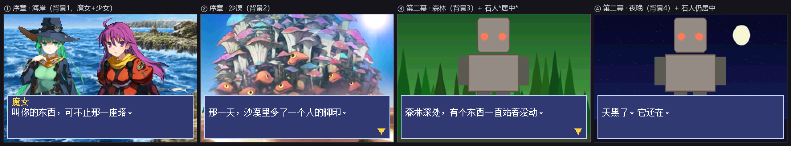

# 13 · 引擎升级（P5）：资源不再写死

P5 之前，引擎只认识**写死的 5 个资源**（两张背景、两个立绘、一个 LOGO）。
编辑器里放第三张背景、第三个角色，实机根本不认 —— 编译器只能提示"已跳过"。

P5 之后：**任意数量的背景、立绘、表情、位置**，全部由项目的素材决定。

---

## 一、先说一个重要的硬件结论

"用硬件精灵（OBJ）会更快" —— 这话对**小**精灵成立，对本项目**不成立**：

| 项 | 数值 |
|---|---|
| GBA 的 OBJ 显存 | **32 KB**（总共） |
| 单个 OBJ 最大尺寸 | 64×64 |
| 一张 111×120 的立绘 | 要拆成 2×2 = 4 个 64×64 的 OBJ |
| 8 位色（256 色）下每块 | 64×64×1 = 4 KB |
| 一块立绘 4 块 | 16 KB → **32 KB 只放得下 2 块立绘** |
| 两张立绘同屏 | 12 块 = 48 KB → **超了** |
| 改用 4 位色（16 色） | 能放下，但**全彩立绘压到 16 色会毁掉画面** |

结论：**继续用软件绘制（模式 3 位图）是对的**。
GBA 的 OBJ 显存装不下大尺寸全彩立绘，改用硬件精灵只会让画面变差。

代价是模式 3 没有双缓冲（切换背景时可能撕裂），但对**静态的 galgame 画面**来说，
撕裂只可能出现在换背景的那一两帧，实际观感没有问题 —— 这是权衡后的选择，不是遗漏。

---

## 二、新的资源管线

```
编辑器导出
   ├─ scenario/scenario.txt      剧本（用**下标**引用资源）
   └─ scenario/assets.json       资源清单（只列这一版用到的）
            ↓  tools/make_project_assets.py
   ├─ source/assets/bg_0.bin …   转换后的像素（BGR555）
   ├─ source/assets/spr_0.bin …
   ├─ source/assets/gfx_data.s   .incbin 声明
   ├─ source/assets/gfx_assets.c 索引表 gfx_bgs[] / gfx_sprites[]
   └─ include/gfx_assets.h       表和计数的声明
            ↓  build.ps1
        ROM
```

关键点：

- **只打包用到的素材**。没用上的背景不进 ROM —— 一张背景 76.8 KB，能省则省。
- **角色+表情在编译时展平成一维表**，所以 C 侧只要 `gfx_sprites[b]`，
  不用在 GBA 上做"角色→表情"的二次查找。
- **下标越界有兜底**：`bg_of()` / `char_of()` 越界回退到第 0 个。
  宁可画面不对，也不能让野指针把 ROM 读崩。
- 素材转换**复用 `tools/make_assets.py` 的函数**，和预览渲染是同一套 ——
  编辑器里看到的立绘，和烧进 ROM 的必然一致。

### 剧本格式的变化

```
旧:  bg bg_ocean          char left witch
新:  bg 0                 char 0 0        # 位置 0=左 1=中 2=右，立绘下标
     bg 1   # 沙漠.png     char 1 2        # 居中放第 3 个立绘
```

行尾注释保留，所以剧本**仍然人可读**。手写剧本也能继续用旧名字（解析器两种都收）。

---

## 三、实测：4 张背景 + 3 个角色

样品工程现在有两幕，第二幕专门用来验证 P5：

| 幕 | 内容 |
|---|---|
| 序章 | 海岸 → 沙漠；魔女（左）+ 少女（右）；7 句台词 |
| 第二幕 | **森林 → 夜晚**；**石人（居中）**；4 句台词 |



① 海岸（背景1）② 沙漠（背景2）③ **森林（背景3）+ 石人居中** ④ **夜晚（背景4）+ 石人仍居中**

第三次、第四次资源全部正确显示，居中位置也正确 —— 这些在 P5 之前**根本编译不过**。

测试素材由 `tools/make_test_assets.py` 生成（绿色森林、星空夜晚、石头人），
风格和真素材完全不同，**一眼就能认出"这个资源真的进了 ROM"**。

```
[assets] bg   #0 海岸  240x160      [assets] spr #0  witch/normal  111x120
[assets] bg   #1 沙漠  240x160      [assets] spr #1  girl/normal   152x120
[assets] bg   #2 森林  240x160      [assets] spr #2  golem/normal   89x120
[assets] bg   #3 夜晚  240x160      [assets] logo                199x53
背景 4 张，立绘 3 张，共 403.1 KB   →   ROM 421.6 KB
```

---

## 四、踩的坑

### 1. 立绘被当成背景转了

`convert()` 里的判断是 `kind == 'char'`，而调用方传的是 `'spr'` ——
于是三张立绘全按背景转成 240×160，**丢掉透明、体积大三倍**：

```
（错）spr #0  240x160  76,800 字节
（对）spr #0  111x120  26,640 字节
```

这类 bug 编译**不报错**，只是画面不对 + ROM 变大。是靠看构建日志里的尺寸发现的。

### 2. 又踩了一次 UTF-8 BOM

用无 BOM 的 UTF-8 改了 `scripts/build-assets.ps1`，PowerShell 5.1 把中文注释
读成乱码，解析器直接崩：

```
ParserError: UnexpectedToken
+ Say ('source\assets\ 鍏?{0} 涓枃浠讹紝...
```

**铁律：改 `.ps1` 必须保留 UTF-8 BOM。** 本会话已经踩过第二次了。

### 3. 行内注释没被解析

编译器输出 `bg 0   # 海岸.png` 便于阅读，但解析器只处理整行注释，
于是把 `0            # 海岸.png` 当成一个 token。现在数字类命令只取前面的 token
（`say` 不这么做 —— 台词里可能出现 `#`）。

---

## 五、还没做的（P6）

| 项 | 状态 |
|---|---|
| 任意背景 / 立绘 / 表情 / 位置 | ✅ 完成 |
| 语音、BGM、音效 | ❌ **引擎还没有音频**，编译时会统计被跳过的片段数 |
| 特效（淡入淡出、震屏） | ❌ 同上 |
| 选项分支（CMD_CHOICE 已有定义） | ❌ 编辑器的时间轴还不能排分支 |
| 存档 | 部分（有暂停菜单和"继续游戏"入口） |

音频是下一块硬骨头，有两个 GBA 特有的约束：
- **只有 1 路语音通道**（所以"语音重叠"在编辑器里是**硬错误**，不是警告）
- 声音数据要占 ROM，8bit/11kHz 约 **11 KB/秒** —— 一句话 3 秒就是 33 KB
